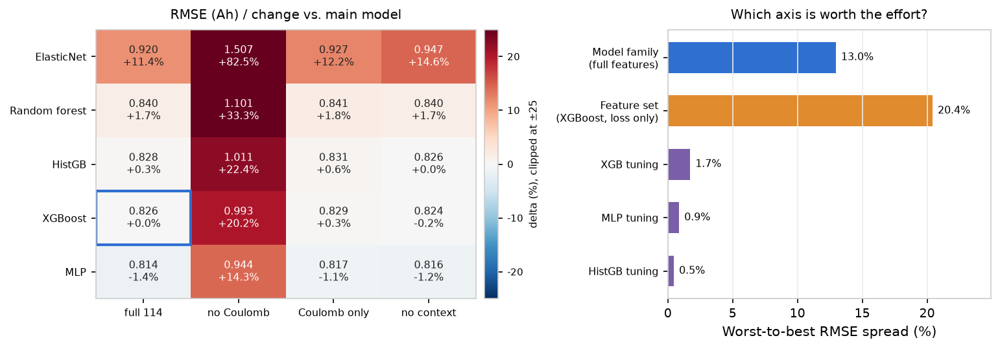
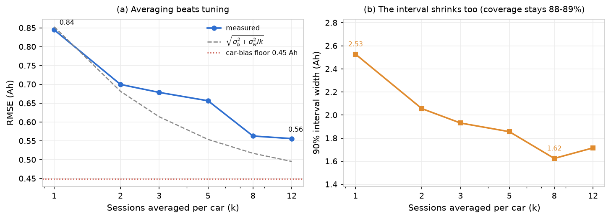

<div align="center">

# How Much Battery Is Left?

### Estimating EV battery capacity and SOH from a single everyday charging session

[](https://github.com/ilo-love7/battery-soh-ev-online/actions/workflows/ci.yml)
[](LICENSE)


<p align="center">
  <b>English</b> · <a href="./README.zh-CN.md">简体中文</a>
</p>

<p align="center">
  
</p>

</div>

---

**One charging session in, capacity (Ah) and SOH (%) out — plus a calibrated 90% interval.**

No full charge, no full cycle, no nameplate capacity, no teardown. A car drives into a charger at 23% SOC, leaves at 71%, and the BMS logs 128-step voltage / current / SOC / temperature windows. That fragment is the entire input. This repository is the full pipeline behind that claim, built and validated on all 1,278,277 windows of the Tsinghua **EVBattery** dataset (464 cars, 173,437 charging sessions).

Four things worth knowing before you scroll:

- **Snippet length sets the error floor.** SOC span ≥ 36% → MAE below **1.5 pp**; ≥ 26% → below **2.0 pp**. Under 25% SOC span the error roughly doubles (0.96 Ah vs 0.49 Ah) — no model fixes a snippet that saw too little of the curve.
- **The coulomb counter alone is worse than guessing the fleet mean.** Integrating BMS current gives 4.42 Ah RMSE versus 2.02 Ah for a constant baseline. The dataset's own `Timestamp` column is not a clock (it restarts at 0 in every window) and the resulting ΔQ/ΔSOC carries a **3.485× scale gap** against the capacity labels. Both traps are documented and handled below.
- **Honest intervals cost width.** Raw quantile regression covers 81.2% at nominal 90%; conformal calibration restores 90.0% for ±2.4 Ah — a 1.94 pp point error with a 5.7 pp interval around it.
- **What is left is the reporting unit, not the model.** Model family, feature set and hyper-parameters are settled: non-linearity is worth 11.5%, but *which* non-linear family only 3.2% and tuning 1.7%. Reporting a car's last 8 sessions instead of one takes RMSE from 0.845 to **0.563 Ah** and the interval from 2.53 to **1.62 Ah**, with no retraining at all.

---

## Features

- **Snippet in, capacity and SOH out.** `tools/soh_estimator.py` takes a folder of BMS window pickles and prints one row per charging session. No configuration, no notebook, no GPU.
- **114 features from two independent families.** Coulomb-count quantities (ΔQ, ΔQ/ΔSOC, energy per 10% SOC band) *and* incremental-capacity shape (dQ/dV on a fixed 3.00–4.25 V grid at 50 mV resolution). The second family is a fallback for a noisy SOC report; §9 shows it adds nothing once the coulomb block is present.
- **A protocol that cannot flatter itself.** The headline number is **grouped by car, 5 folds** — test vehicles are never seen in training. Same-car random splits and leave-one-vendor-out transfer are reported alongside, clearly labelled as the optimistic and the pessimistic bound.
- **Calibrated 90% intervals.** Quantile regression (P5/P50/P95) plus three calibration routes — CV+, normalized conformal, and **CQR**, which is the one to use: same width as CV+, but its worst SOC-span bin is 1.8 pp off nominal instead of 15.1 pp.
- **Cold-start personalization with both splits.** Correct each car's bias from `k` labelled sessions and report the gain under a *chronological* split (deployable) and a *same-distribution* split (potential ceiling), because they differ by 4×.
- **Condition invariance, tested rather than assumed.** A gradient-reversal head on the temperature task cuts the coldest-bin MAE by 11.6% and overall RMSE by 2.1%, while the intuitive post-hoc residual correction does nothing — and the repository shows why (15% signal-to-noise).
- **Reproducible end to end.** 20 numbered scripts, 10 library modules, 39 unit tests, every figure and JSON in this README regenerated by a command.

## Results

Leave-cars-out (P2), 38,744 labelled sessions from 191 cars, target = absolute capacity in Ah:

| Model | RMSE (Ah) | MAE (Ah) | R² | SOH RMSE (pp) |
|---|---|---|---|---|
| Constant baseline (fleet mean) | 2.021 | 1.631 | −0.005 | 4.73 |
| Coulomb count, scale-calibrated | 4.420 | 3.247 | −3.805 | 10.34 |
| Elastic net | 0.920 | 0.610 | 0.792 | 2.16 |
| Random forest | 0.832 | 0.571 | 0.830 | 1.95 |
| **XGBoost (main model)** | **0.826** | **0.560** | **0.832** | **1.94** |
| XGBoost, **strict leave-one-car-out (191 folds)** | **0.812** | **0.550** | **0.838** | **1.90** |
| XGBoost, same-car random split (P1, optimistic) | 0.728 | 0.461 | 0.870 | 1.71 |
| MLP, 2 × 64 units (best cell found, 2.5× slower) | 0.807 | 0.547 | 0.840 | 1.89 |

**The coulomb-count block is necessary; the shape block is not additive.** Removing the coulomb-count group costs 20% (0.826 → 0.993 Ah) in every model family, and keeping only coulomb-count costs 0.4% (0.829): the coulomb quantities carry the absolute charge scale, and shape features cannot supply it because they are scale-free. But the reverse edit is almost free — dropping all 45 incremental-capacity dimensions costs 0.3%, and the MLP is 1.1% *better* without them (§9). Shape features are a fallback for a bad SOC report, not a second source of accuracy.

The MLP row is the best cell of the §9 grid and is listed for completeness; XGBoost stays the main model because it trains in 8 s per fold against 19.7 s, for a 2.3% gap.

<p align="center">
  
</p>

**Intervals.** Quantile regression is overconfident on unseen cars; two independent calibration routes both land on nominal coverage at a similar width, which is the useful signal (a single calibration that happened to work would be luck).

<p align="center">
  
</p>

**Cross-vendor transfer** (train on two vendors, test on the third): direct transfer stays within **|bias| ≤ 0.21 Ah** — 0.882 Ah / R² 0.67 on `battery_dataset2`, 1.138 / 0.64 on `dataset1`, 1.516 / 0.06 on `dataset3` (8 cars only). Unsupervised alignment makes it **worse** everywhere (0.882 → 2.341 Ah for z-score alignment), because it erases the absolute charge scale that carries the capacity information. That negative result is kept, not hidden; see [Going deeper](#going-deeper) §2 for the second-order version of the same failure.

**Cold start.** Correcting a per-car bias from labelled sessions helps — but how much depends entirely on which direction time runs:

<p align="center">
  
</p>

Under a same-distribution split, 20 sessions buy **11.8%** MAE reduction; under a chronological split the same 20 sessions buy **2.9%**. The gap is not a bug: a car's bias drifts as the pack ages, so "calibrate on the future" is not available in deployment. Both numbers are reported for every `k` in `results/metrics/coldstart.json`.

**How long a snippet do you need?** Error falls monotonically with SOC span and then flattens — past roughly 60% the extra coverage stops paying:

<p align="center">
  
</p>

## Install

```bash
git clone https://github.com/ilo-love7/battery-soh-ev-online.git
cd battery-soh-ev-online
python -m venv .venv
source .venv/bin/activate          # Windows: .venv\Scripts\activate
pip install -r requirements.txt
```

Python 3.10–3.12. CPU only. `torch` is a dependency for one reason: EVBattery ships its window pickles in the legacy PyTorch serialization format, and they must be read with `torch.load(..., weights_only=False)`. No neural network is trained anywhere in this repository.

## Quick start

Three real charging sessions are committed under `examples/sample_sessions/` (38 window files, 403 KB, 8–17 windows each), so this runs immediately after `pip install` — no 13.7 GB download:

```bash
python tools/soh_estimator.py \
  --dir examples/sample_sessions \
  --ref-capacity "18=42.8,62=41.4,383=43.1"
```

```
Model: results/models/xgb_capacity.joblib  (38,744 sessions / 191 cars, leave-cars-out RMSE 0.83 Ah)

 car segment  d_soc  duration_h  n_windows  quality  capacity_Ah  ref_Ah  soh_pct status
  18     368   85.1        6.00         17    0.994        40.15    42.8     93.8     ok
  62     282   54.9        4.59         13    0.960        38.38    41.4     92.7     ok
 383     276   30.0        2.82          8    0.793        41.21    43.1     95.6     ok
```

Column meanings: `d_soc` is the SOC span the snippet actually covered (%), `quality` is the snippet's 0–1 usability score, `capacity_Ah` is the model's absolute capacity estimate, `ref_Ah` is the BOL reference you supplied, `soh_pct = capacity_Ah / ref_Ah`.

The reference capacities above are the ground-truth BOL values for these three cars, taken from the dataset's label history. The published labels are 40.24 / 37.50 / 41.57 Ah, so the three estimates are off by 0.09 / 0.88 / 0.36 Ah.

Two things to note about `--ref-capacity`:

- It accepts a scalar (`--ref-capacity 42.0`) or per-car pairs (`18=42.8,62=41.4`). Omit it and the fleet mean BOL (42.6 Ah) is used, which makes `soh_pct` a fleet-relative number, not a per-vehicle one.
- SOH is **relative to the car's own beginning-of-life capacity**, because the dataset has no nameplate ratings. Comparing SOH across different models is meaningless; compare `capacity_Ah` instead.

Add `--json out.json` to get the same table as machine-readable records.

## Bring your own data

The full dataset is on figshare ([10.6084/m9.figshare.23301881](https://doi.org/10.6084/m9.figshare.23301881), CC BY-NC-SA). Lay it out as:

```
EVBattery/
  battery_dataset1/data/  *.pkl
  battery_dataset2/data/  *.pkl
  battery_dataset3/data/  *.pkl
```

Point the pipeline at that root either by editing `paths.evbattery_root` in `configs/config.yaml` or by exporting `EVBATTERY_ROOT`. Then either drop a session's window files into one folder and use `--dir`, or name the files directly:

```bash
python tools/soh_estimator.py --files 470521.pkl 470522.pkl 470523.pkl \
  --data-root /path/to/EVBattery/battery_dataset1 \
  --ref-capacity 42.0
```

The model bundle (`results/models/xgb_capacity.joblib`, 3.5 MB) ships with the repository and contains the model, the ordered feature list, the fleet BOL mean and the physics scale factor — so the estimator works on a fresh clone without retraining.

## How it works

| Stage | Choice |
|---|---|
| Snippet filtering | Window: 128 complete steps, non-idle current, no SOC jump > 30%. Session: ΔSOC ≥ 20%, ≥ 1 valid window |
| Features (114) | ① Coulomb: ΔQ, ΔQ/ΔSOC, charge per 10% SOC band ② **IC dQ/dV binned on a fixed 3.00–4.25 V grid (50 mV)** — 25 raw + 25 normalized ③ crossing time and charge over 5 coarse voltage windows ④ operating context and a 5-component quality score |
| Label | `SOH = capacity / BOL reference`, where the reference is the **median of the car's top 10% capacity labels** (robust BOL proxy). The model regresses **absolute capacity**; SOH is derived afterwards, so the label never leaks into the target |
| Protocol | P1 same-car random (optimistic bound) / **P2 grouped by car, 5 folds (headline)** / leave-one-vendor-out |
| Intervals | Quantile regression P5/P50/P95 + **CQR (the one to use)**, with CV+ and normalized conformal as comparison baselines; PIT histogram for diagnostics |
| Personalization | Per-car affine bias correction from `k` sessions, shrunk toward identity (λ = 5); chronological and same-distribution splits reported separately |

## Two traps in the EVBattery format

Both cost real time to find, so they are documented here and asserted in `tests/`.

**1. `Timestamp` is not a clock.** Column 8 restarts at 0 inside *every* window, so sorting windows by `t_start` collapses a 17-window session into a single window. The correct order is the **global window index encoded in the filename** (`219441.pkl < 219442.pkl < ...`): within a session, consecutive indices differ by exactly 1 in 100% of cases, and sorting by index makes SOC monotonic in 99.9% of sessions. `src/evsoh/session.py` rebuilds a global time axis from the file index.

**2. Raw ΔQ/ΔSOC is off by a constant 3.485×.** Integrating `Charging_Current` over `Timestamp` and dividing by ΔSOC gives a quantity that is proportional to capacity but scaled wrong — the factor is stable (IQR 0.43 around 3.485, equivalent to a ~2.87 s effective timestep) yet varies ~12% sample to sample. This is exactly why the "physical" baseline scores 4.42 Ah while a constant scores 2.02 Ah. `src/evsoh/session.py` stores both raw and scale-corrected quantities, and `scripts/04_physics_baseline.py` fits the factor on the training fold only.

## Reproduce the full pipeline

```bash
export EVBATTERY_ROOT=/path/to/EVBattery   # or set paths.evbattery_root in configs/config.yaml
python -m pytest tests/ -q                 # 39 unit tests
python scripts/01_index_windows.py --workers 16    # 1.28 M windows  → ~10 min
python scripts/02_session_features.py --workers 14 # 38,744 sessions → ~3 min
python scripts/03_eda.py                   # data audit + figures 1–5
python scripts/04_physics_baseline.py      # coulomb-count baseline + figure 6
python scripts/05_train_models.py          # training / ablation + figures 7–10, ~11 min
python scripts/06_generalization.py        # leave-one-vendor-out + figure 11
python scripts/07_uncertainty.py           # 90% intervals + figures 12–13
python scripts/08_coldstart.py             # personalization + figures 14–15
python scripts/09_error_analysis.py        # stratified errors + figures 16–17
python scripts/10_readme_figures.py        # English-labelled figures in docs/figures/

# deeper analyses (added after the first release, see "Going deeper" below)
python scripts/11_ic_peaks.py              # IC peak features on the 50 mV grid + figures 18–19
python scripts/12_lovo_decomposition.py    # strict leave-one-car-out (191 folds) + figures 20–21
python scripts/13_cqr.py                   # CQR intervals + conditional coverage + figure 22
python scripts/14_personalize_quality.py   # personalization strategies + quality gate + figures 23–24
python scripts/15_ic_fine.py               # 10 mV IC on 3000 sampled sessions + figures 25–26
python scripts/16_condition_norm.py        # temperature invariance (GRL) + figures 27–28
python scripts/17_sequence_model.py        # raw curves vs manual features + figures 29–30
python scripts/18_ensemble_intervals.py    # deep ensemble vs CQR + figures 31–32
python scripts/19_model_frontier.py        # 5 families × 4 feature sets × 6 variants + figures 33–34, ~38 min
python scripts/20_interval_floor.py        # same-car averaging + label-noise floor + figures 35–36
```

`EVBATTERY_ROOT` must point at the directory containing `battery_dataset1/2/3`. Scripts 17 and 18 need either the raw pickles or the caches from steps 01–02; everything else reads only `session_features.parquet`.

Steps 01–02 cache to `results/cache/` (not committed; ~110 MB, regenerate in ~13 min on 16 cores). Steps 03–20 write 36 Chinese-labelled figures to `results/figures/` and 20 metric JSONs to `results/metrics/`. `scripts/10` only re-renders the thirteen figures used above from cached results, so it needs the corresponding scripts to have run.

Scripts 11–20 support cache reuse, so iterating on a figure does not mean retraining:

| Flag | Effect |
|---|---|
| `REUSE_LOVO=1` | reuse `lovo_predictions.parquet`, skip the 191-fold refit (~15 min → 0) |
| `REUSE_CORAL=1` | reuse `lovo_domain_transfer.json`, skip the three vendor-held-out fits |
| `REUSE_PERS=1` | reuse script 14's JSONs, redraw only |
| `--replot` (scripts 11 / 15 / 16 / 17 / 18 / 19 / 20) | redraw figures from saved results |
| `--diag-only` (script 18) | recompute only the cross-fitted residual diagnostic, ~3 min |
| `SMOKE=1` (scripts 16 / 17 / 19) | run a single fold to validate the plumbing |
| `ONLY_SET=<set>` (script 19) | fit one feature-set column only, then `--assemble` to merge |

Repository layout:

```
configs/config.yaml     paths, snippet filters, label definition, protocols
src/evsoh/              config · data · session · features · target · models
                        evaluate · personalize · nn · plotting
scripts/01–20           the pipeline above
tools/soh_estimator.py  end-to-end CLI (pkl → capacity / SOH / quality)
examples/sample_sessions/  3 real sessions, 38 window files
docs/figures/           the thirteen English-labelled figures in this README
results/models/         xgb_capacity.joblib (3.5 MB, committed)
reports/                full Chinese evaluation report (994 lines, all numbers)
```

## Going deeper

Ten follow-up studies, run after the first release and reproduced by `scripts/11`–`20`. Two of them sharpened a headline number and one bought a real improvement (condition invariance); the rest are negative results kept on purpose, because each one bounds what a plausible idea can actually buy.

### 1. Incremental-capacity peaks: real, but not worth the parameters

dQ/dV peaks are the textbook SOH indicator, so the obvious move is to detect them and feed peak position / height / width to the model. On the 50 mV grid that fails for a mechanical reason: **96.8% of sessions yield exactly one peak** (37,503 of 38,744), because 50 mV is too coarse to resolve the two phase transitions separately.

| Feature set | Features | RMSE (Ah) | Δ RMSE |
|---|---|---|---|
| 50 mV IC bins (baseline) | 114 | **0.826** | — |
| + 20 peak descriptors | 134 | 0.824 | −0.3% |
| Bins **replaced** by peaks | 111 | 0.887 | **+7.3%** |

Re-sampling 3,000 sessions (stratified by SOH quintile) onto a **10 mV** grid shows the peak structure is real — the modal session has four peaks — and that the **second** peak is the sharp one: Spearman ρ with SOH is **+0.354**, against +0.144 for the first peak. Finer resolution still does not pay:

| Feature set | Features | RMSE (Ah) |
|---|---|---|
| 50 mV bins | 48 | **0.898** |
| 10 mV bins | 100 | 0.910 |
| 10 mV bins + peaks | 125 | 0.908 |
| Peaks only | 48 | 1.133 |

The 25 binned values already contain what the peaks summarise, and peaks throw away the rest of the curve. Verdict: **interpretability gain, accuracy loss.** The bins stay.

### 2. Strict leave-one-car-out: the 5-fold number was not flattering itself

The headline protocol groups by car in 5 folds, so any two training sets still share roughly **115 of the 191 cars** — the folds are not independent. Re-running as **191 folds, one car held out at a time** (913 s, 8 processes):

| Protocol | RMSE (Ah) | MAE (Ah) | R² | SOH RMSE (pp) |
|---|---|---|---|---|
| Grouped 5-fold by car (headline) | 0.826 | 0.560 | 0.832 | 1.94 |
| **Strict leave-one-car-out (191 folds)** | **0.812** | **0.550** | **0.838** | **1.90** |

Strict LOVO is *slightly better*, not worse — with 190 training cars each fold, the extra data outweighs the harder protocol. The tail is where the difficulty lives: per-car RMSE median 0.70 Ah, p90 1.15 Ah, worst 3.17 Ah, and **all four worst cars come from `battery_dataset3`** (the 8-car vendor).

Regressing per-car RMSE on two feature blocks separates what is fixable from what is not:

| Block | R² alone | Marginal contribution |
|---|---|---|
| Snippet attributes (SOC span, quality, temperature, C-rate, #sessions) | 18.9% | **+11.6 pp** |
| Car identity (mileage, BOL capacity, chemistry, SOH spread) | 55.8% | **+48.5 pp** |
| Both | **67.4%** | — |

<p align="center">
  
</p>

Two thirds of cross-car error is explained, and most of it by *who the car is*. That is the quantitative version of "snippet length is a hard floor": the remaining 32.6% is where a better model could still win. One caveat on the coefficients — within the attribute block only `quality_med` keeps a stable sign (ρ = −0.23, standardised coef −0.26); the SOC-span coefficient flips positive once vendor dummies enter, because the few `dataset3` cars have both long snippets and large errors. Between-car regressions with 191 rows and collinear regressors do that.

**Domain alignment does not help.** CORAL (whitening the source domain and re-colouring it with the target covariance) is the standard second-order fix, and it loses to doing nothing on every held-out vendor:

| Held-out vendor | No alignment | z-score align | CORAL |
|---|---|---|---|
| `battery_dataset1` | **1.139** | 1.609 | 2.073 |
| `battery_dataset2` | **0.884** | 2.595 | 2.024 |
| `battery_dataset3` | **1.506** | 2.082 | 2.234 |

The failure mode is specific: matching first- or second-order statistics *rescales* the feature space, and the absolute charge scale is the signal. A method that equalises distributions destroys it by construction. Unsupervised alignment cannot fix a problem that is about scale, not about distribution.

The z-score column here reads 2.595 Ah on `dataset2` rather than the 2.341 Ah quoted in the Results section: this run median-imputes the features before taking moments, the earlier one used NaN-aware moments. Same effect, same conclusion — the two are not interchangeable, so both are reported.

### 3. Conformalized quantile regression: same width, far better conditional coverage

Four interval methods at nominal 90%, all evaluated on the same 38,744 out-of-fold predictions:

| Method | Coverage | Width (Ah) | Width (pp SOH) | Worst SOC-span bin |
|---|---|---|---|---|
| Raw quantile regression | 79.8% | 1.92 | 4.51 | 11.2 pp off |
| CV+ | 90.0% | 2.44 | 5.72 | **15.1 pp off** |
| Normalized conformal | 89.9% | 2.54 | 5.97 | 3.0 pp off |
| **CQR** | 89.5% | **2.45** | 5.75 | **1.8 pp off** |

CV+ and CQR land on the same global coverage at the same width — and then diverge completely on *where* the coverage sits. CV+ adds one constant to every interval, so it over-covers long snippets (92.6% on 70–100% SOC span) and badly under-covers short ones (**74.9% on 20–30%**). CQR calibrates the quantile *spread* instead, so the intervals stay asymmetric and the span bins land between 88.2% and 91.3%.

<p align="center">
  
</p>

This is the one place where a follow-up study changed the recommendation: **CQR replaces CV+ as the interval method of choice.** The per-fold correction is 0.27 Ah on average (range 0.18–0.42), and calibration uses 25% of the training cars in each fold — 7,000–8,400 sessions, never a test car.

### 4. Personalization: which correction, and which sessions to label

Three corrections were compared under both splits — a single bias term, a full per-car affine map `a·p + b`, and a 3-parameter ridge head shrunk toward identity:

<p align="center">
  
</p>

| Strategy (chronological split) | k=1 | k=5 | k=20 | vs zero-shot |
|---|---|---|---|---|
| Bias only | 0.599 | 0.596 | 0.585 | **+2.9%** |
| Affine `a·p+b` | 0.875 | 0.692 | 0.610 | −1.2% |
| Ridge head | 0.893 | 0.707 | 0.633 | −5.1% |
| **Bias + pick the best k** | **0.585** | **0.568** | **0.560** | **+7.1%** |

Two findings. First, **more parameters are not better**: at k=1 the affine map degrades MAE by 45% and the ridge head by 47%, and neither ever beats a single bias term, even at k=20. A per-car offset is the only correction this data supports. Second, **which sessions you label matters as much as how many**: choosing the `k` sessions with the highest quality × SOC span lifts the chronological gain from 2.9% to 7.1%, and already pays at k=1.

Under the same-distribution split the ordering flips — plain bias correction reaches 12.6% at k=20, while quality-based selection reaches only 10.7%. Picking long, clean snippets helps when bias *drifts* (their bias estimate is less noisy); when bias is stationary, it just throws away diversity.

### 5. Quality gate and robust features: one works, one does not

**Rejecting low-quality snippets works, and is monotone.** The model is untouched; snippets below a quality threshold are simply not reported:

| Quality threshold | Sessions retained | MAE (Ah) |
|---|---|---|
| none | 100% | 0.560 |
| ≥ 0.80 | 90.5% | 0.534 |
| ≥ 0.85 | 79.0% | 0.520 |
| ≥ 0.90 | 64.3% | 0.511 |
| ≥ 0.95 | 46.2% | **0.483** |

Dropping the worst half of snippets buys 13.8% MAE. That is a *coverage* trade, not a modelling gain, but it is the right trade for fleet screening: a session you refuse to score costs nothing, a wrong number costs a warranty decision.

**Dropping C-rate/temperature-sensitive features does not buy robustness.** Removing all 58 features with |Spearman| ≥ 0.35 against mean current or mean temperature (114 → 56 features) costs 3.6% RMSE overall (0.826 → 0.856), and the cost is concentrated exactly where robustness was wanted:

| Stratum | All 114 features | Robust 56 features |
|---|---|---|
| Cold (< 15 °C) | 0.810 | 0.824 (+1.7%) |
| Mid (15–30 °C) | 0.601 | 0.618 (+2.8%) |
| Hot (≥ 30 °C) | **0.404** | **0.449 (+11.1%)** |

The cold/hot MAE ratio barely moves (2.0× → 1.8×) while the hot stratum gets 11% worse. Features that correlate with C-rate and temperature are carrying real capacity signal — mostly because a hot, high-current session is a *long* session — so deleting them removes information rather than bias. Temperature compensation needs an explicit physical model, not feature filtering.

### 6. Condition normalisation: temperature invariance has to be bought in the representation

The first release flagged a 2.3× error gap between cold and hot snippets with no explicit compensation, and the section above shows that deleting temperature-correlated features does not fix it. This round implements the two routes that leaves — correct at the feature/label level, or constrain the training objective — plus a naive post-hoc correction as a control. All five run inside the same 5-fold-by-car split, with every statistic estimated on the training fold only.

| Method | Where it acts | RMSE (Ah) | Δ | Worst/best temp MAE |
|---|---|---|---|---|
| XGBoost baseline | — | 0.8227 | — | 2.54× (0.360–0.913) |
| Post-hoc residual correction | output | 0.8243 | +0.2% | 2.45× |
| Decorrelate all features | features | 0.8414 | +2.3% | **2.15×** |
| Decorrelate shape features only | features | 0.8241 | +0.2% | 2.61× |
| MLP, no adversarial head | model | 0.8202 | −0.3% | 2.35× |
| **MLP + gradient reversal (GRL)** | **representation** | **0.8052** | **−2.1%** | **2.24×** |

The `MLP, no adversarial head` row is not decoration. Without it, "GRL works" and "an MLP is simply better than XGBoost here" are indistinguishable. Splitting the two: swapping the model buys −0.3% (noise), and turning on the adversarial objective buys another **−1.8%** while pulling the temperature ratio from 2.35× to 2.24×. That 1.8% is the invariance constraint, not model capacity.

**Why the post-hoc correction fails** is worth stating precisely, because it is the intuitive thing to try. Binned by temperature, the residual median drifts from −0.23 Ah (< 10 °C) to −0.05 Ah (> 36 °C) — a span of 0.18 Ah — while the residual interquartile range is 1.2 Ah. A 15% signal-to-noise ratio is not learnable by any low-capacity corrector; the in-fold residual MAE actually got *worse* (0.5839 → 0.5920). The temperature sensitivity is not a leftover offset in the output, it is in the map from features to capacity: the model under-reads capacity in the cold because low voltage and high internal resistance look like degradation. So the fix has to be at the representation.

The gain distribution confirms it. Almost all of it lands in the coldest bin:

| Temperature | n | XGBoost MAE | GRL MAE | Δ |
|---|---|---|---|---|
| < 10 °C | 122 | 0.913 | 0.807 | **−11.6%** |
| 10–18 °C | 8,379 | 0.761 | 0.747 | −1.9% |
| 18–24 °C | 9,352 | 0.621 | 0.604 | −2.8% |
| 24–30 °C | 8,929 | 0.510 | 0.498 | −2.3% |
| 30–36 °C | 8,691 | 0.418 | 0.408 | −2.3% |
| > 36 °C | 3,271 | 0.360 | 0.360 | +0.2% |

Decorrelating all features reaches an even lower ratio (2.15×) but does it by destroying information: the coldest bin gets *worse* (0.913 → ~0.901 at the cost of 2.3% overall RMSE). That is buying flatness with accuracy. GRL is the only variant that improves both.

The cost is honest: GRL needs an MLP, which is an order of magnitude slower than XGBoost and adds two hyper-parameters (adversarial strength λ, number of temperature bins). For offline scoring that is fine; for on-vehicle inference it needs distillation back into a tree model.

### 7. Sequence model vs hand-crafted features: the features are an asset, not a bottleneck

The whole pipeline uses 114 hand-crafted features. The obvious question is why not feed the raw 128×8 windows to a network. This round answers it on **the same 11,966 sessions and the same 5-fold-by-car split**, separating "representation" from "model":

| Representation | Model | RMSE (Ah) | MAE | R² | Δ |
|---|---|---|---|---|---|
| 114 manual features | XGBoost | 0.8519 | 0.5769 | 0.8221 | — |
| 114 manual features | MLP | **0.8267** | **0.5547** | **0.8325** | −3.0% |
| Raw curves (256×5) | 1D CNN | 1.0801 | 0.7689 | 0.7141 | **+26.8%** |

The sequence side handles the "snippets of different lengths" problem by resampling each trajectory along the **SOC axis** (not the time axis) to 256 points, with five channels: V, I, T, dV·dSOC⁻¹, and a coverage mask. Different lengths and different start points then align on SOC, and the mask says which stretch is actually observed.

**The result is counter-intuitive: raw curves are clearly worse (+26.8%).** This is not an under-trained network — early stopping, gradient clipping and winsorisation are all in place, and the training loss descends normally. The manual features encode quantities a CNN would have to learn from scratch: coulomb-count integrals ΔQ, ΔQ/ΔSOC, and IC bins. These are *integral* quantities, needing the network to accumulate along the SOC axis, and there are only 12k sessions with one curve each. Three convolutions with two poolings give a receptive field of ~40 grid points, under a sixth of the SOC range.

**Does the sequence model rescue short snippets? No.** The original hypothesis was that curves should win where cumulative charge is unreliable:

| SOC span | XGBoost + manual | MLP + manual | 1D CNN + curves |
|---|---|---|---|
| 20–30% | 0.907 | 0.913 | 1.130 |
| 70–100% | 0.548 | 0.521 | 0.716 |

The relative disadvantage is slightly smaller on short snippets (24.5% vs 30.6%), but the absolute error is worse everywhere. Short snippets are hard because of missing information — the SOC only moved 20 points — and no representation conjures information back.

**The one positive finding**: the three representations have error correlations of xgb–mlp **0.911**, xgb–seq **0.708**, mlp–seq 0.718, so the sequence model really is more independent. Blending it into XGBoost at the optimal 15% weight takes RMSE from 0.8519 to 0.8454 (−0.8%). But the same blend benefit is available for free by averaging XGBoost and the MLP: 0.8519 → 0.8196 (−3.8%). Changing the representation is a far worse investment than changing the model.

**Revision (section 9).** The full grid agrees on the ordering but narrows both numbers: non-linearity is worth 11.5%, the choice among non-linear families only 3.2%, and the representation has no upside left at all — the 45 shape dimensions are redundant once the coulomb block is present.

### 8. Interval width has hit the noise floor

The first release reported a ±2.4 Ah interval and called it wide. This round adds the third option the deepening document asked for — a deep ensemble — and settles whether the width can be reduced at all.

| Method | Coverage | Width (Ah) | Width (pp) | Below / above | Worst bin deviation |
|---|---|---|---|---|---|
| Quantile regression P5/P95 | 79.8% | 1.921 | 4.51 | 8.5% / 11.7% | 11.2 pp |
| **CQR** | **89.5%** | 2.452 | 5.75 | **5.3% / 5.2%** | **1.7 pp** |
| Deep ensemble (7 seeds) | 19.9% | 0.335 | 0.79 | 35.7% / 44.4% | 72.4 pp |
| Ensemble + conformal | 90.0% | **2.364** | 5.55 | 6.9% / 3.1% | 10.8 pp |

**The deep ensemble fails outright**: seven MLPs give a 5–95% spread of 0.335 Ah and 19.9% coverage. They are trained on the same data, with the same architecture, differing only in initialisation, so their predictions are highly correlated. Ensemble spread measures *model* uncertainty; the error here is dominated by *label* noise. Different things.

Calibrating the ensemble (last row) gets the width down to 2.364 Ah — 3.6% narrower than CQR, which looks like a win until you look at conditional coverage: the worst bin is off by 10.8 pp (CQR: 1.7 pp), and the 20–30% span bin covers only 79.2%. Same failure mode as CV+: the ensemble interval barely varies with snippet length, so a single conformal constant over-covers long snippets and under-covers short ones. CQR's quantile regressors have the conditional heteroscedasticity built in.

**Can the width be reduced? No.** Two pieces of evidence:

1. Predicting `|residual|` from the features, with 5-fold-by-car cross-fitting, gives R² = **0.145** (in-sample fitting reports 0.267, roughly double). Only 14.5% of the residual is learnable structure; 85% is noise.
2. The median `|residual|` is 0.381 Ah and its P90 is 1.218 Ah. The smallest symmetric 90% interval the residual distribution allows is 2 × P90(|r|) = **2.436 Ah**. CQR measures 2.452 Ah — essentially on the floor.

So 2.45 Ah is not a method limitation, it is a label-noise limitation. Narrowing it requires better labels (measured ampere-hour integration instead of the authors' estimates) or per-vehicle history, which is a different assumption.

**Revision (section 10).** This floor is per snippet. Averaging the last k sessions of the same car takes the width to 1.62 Ah at k=8, and a direct measurement puts label noise at 41% of the variance rather than 85%. Read the floor as "what one snippet can tell you", not as "what the dataset can tell you".

### 9. Which axis is worth the effort: model family, representation, or hyper-parameters?

Section 7 closed with the claim that changing the model beats changing the representation, on the strength of two pairwise comparisons. This round puts all three axes on one grid — 5 model families × 4 feature sets, plus 6 within-family hyper-parameter variants, on the same car-grouped 5 folds. Parentheses are the change against the current main model (full features + XGBoost, 0.8260 Ah):

| Model family | full, 114 dims | no Coulomb | Coulomb only | no condition context |
|---|---|---|---|---|
| ElasticNet (linear) | 0.920 (+11.4%) | 1.507 (+82.5%) | 0.927 (+12.2%) | 0.947 (+14.6%) |
| Random forest | 0.840 (+1.7%) | 1.101 (+33.3%) | 0.841 (+1.8%) | 0.840 (+1.7%) |
| HistGB | 0.828 (+0.3%) | 1.011 (+22.4%) | 0.831 (+0.6%) | 0.826 (+0.0%) |
| **XGBoost (main model)** | **0.826** | 0.993 (+20.2%) | 0.829 (+0.3%) | 0.824 (−0.2%) |
| MLP | 0.814 (−1.4%) | 0.944 (+14.3%) | 0.817 (−1.1%) | 0.816 (−1.2%) |

**A methodological catch first**: `ABLATIONS["curve_only"]` and `ABLATIONS["no_coulomb"]` are the *same set* under the grouping rules (everything minus the Coulomb features = shape + SOC duration + context), so two of the four columns would have been identical. The fourth column is `no_context` instead, and the equivalence is now noted in the script. One row also differs from the results table above: the forest here is a cost-reduced 300-tree / depth-12 fit (0.840 vs 0.832), because the grid is 20 fits, not one.

**Axis 1 — non-linearity is worth 11.5%, the choice of non-linear model only 3.2%.** The linear model sits at 0.920 while all four non-linear families land in 0.814–0.840. So "should I use a non-linear model" is worth 11.5%, and "random forest or XGBoost or MLP" is worth 3.2%. The task is insensitive to the model family, sensitive only to whether there is any non-linearity.

**Axis 2 — the representation has no upside left, only downside.** `full` is the best of the four. Dropping the Coulomb features is the only fatal edit (+14.3% for the MLP, +82.5% for the linear model). Section 6.2 suggested the IC shape features could "back up" a missing Coulomb signal; this round says no — the best model only softens the loss from +82.5% to +14.3%. And 45 shape dimensions are worth **nothing** given Coulomb + context (0.829 vs 0.826, and the MLP is actually 1.1% better without them). Dropping the 27 condition-context features costs nothing either.

**Axis 3 — tuning is nearly worthless.** XGB's three variants span 1.7% (best: shallower and more regularised, −0.9%), HistGB 0.5%, MLP 0.9%. Going *deeper* is a loss (+0.8%): 900 trees at depth 6 already overfit at this data size.

**Best cell and its price**: `full + mlp_narrow` (64-unit two-layer MLP) at 0.8073 Ah, 2.3% better than the main model, for 2.5× the training time (19.7 s vs 8.0 s per fold). The best value is `xgb_shallow`: −0.7% at 2.8 s.

**An interesting interaction**: the MLP's edge over XGBoost grows as the representation gets weaker — −1.4% on full features but **−4.9%** without the Coulomb block (0.9442 vs 0.9929). The network really does squeeze more out of shape features, but nowhere near enough to replace the missing Coulomb information, which is also why the raw-sequence CNN of section 7 could not rescue anything: what is missing is information, not representational flexibility.

<p align="center">
  
</p>

### 10. The interval was not at the floor — the reporting unit was too narrow

Section 8 concluded that 2.45 Ah is a label-noise floor. That is true for **one snippet reported on its own**. It is not how a vehicle is used: a car charges hundreds of times a year, and the sensible thing to report is the average of its last *k* sessions. Same OOF predictions, no retraining, only the reporting unit changes:

| Sessions averaged, k | RMSE (Ah) | MAE (Ah) | 90% width (Ah) | Coverage |
|---|---|---|---|---|
| 1 (single snippet) | 0.845 | 0.586 | 2.53 | 88.7% |
| 2 | 0.700 | 0.499 | 2.06 | 88.7% |
| 3 | 0.679 | 0.476 | 1.93 | 88.0% |
| 5 | 0.657 | 0.448 | 1.86 | 89.3% |
| 8 | **0.563** | **0.404** | **1.62** | 88.5% |
| 12 | 0.556 | 0.401 | 1.72 | 88.9% |

Each car is cut into consecutive windows by odometer, capped at 12 windows per car and per *k* so that every car counts equally, and only cars with at least 12 sessions enter — every *k* is measured on the same vehicles. The k=1 value (0.845) is car-equal-weighted and therefore differs slightly from the session-weighted 0.826 in the main table.

**The gain is not 1/√k.** The variance decomposition (σ_b = 0.449, σ_w = 0.725) predicts `√(σ_b² + σ_w²/k)`; the measured curve sits 3–19% above it. Solving the measured curve for an *effective* number of independent sessions gives 1.0, 1.8, 2.0, 2.3, 4.6 and 4.9 for k = 1…12. Twelve sessions buy the information of about five — within-car errors are positively correlated, and the error budget below says why.

**It is not just a proxy for longer snippets.** Comparing k=1 with k=4 inside each SOC-span bin, the gain survives everywhere: −39% (30–40% span), −19% (40–50%), −25% (50–60%), −25% (60–70%), −15% (70–100%). Short snippets measured repeatedly beat waiting for a long one.

**Practical recipe** — to reach a target width: 2.5 Ah needs k=2, 2.0 Ah needs k=3, 1.8 Ah needs k=8, and 1.5 Ah is **unreachable** for k ≤ 12.

**Why the averaging saturates, measured directly.** Two adjacent sessions of the same car should carry almost the same true capacity, so their label difference is essentially the noise difference (after removing each car's linear capacity–mileage trend):

- **19.8% of adjacent session pairs carry exactly the same capacity label.** A continuous quantity does not repeat by chance — labels come from a sparser set of measurements and are copied onto neighbouring sessions. The runs average 1.24 sessions and reach 7.
- The distribution is a **spike plus heavy tails**: σ from the standard deviation is 0.547 Ah, σ from the MAD is 0.204 Ah, a factor of 2.7.

Splitting the variance by whether averaging can remove it:

| Component | σ (Ah) | Share of variance | Removed by averaging? |
|---|---|---|---|
| Car-level bias | 0.449 | 28% | No — hard floor |
| Within-car model error | 0.476 | 31% | Yes, as 1/√k |
| Label noise | 0.547 | 41% | Partly (copied labels are perfectly correlated) |
| **Total** | **0.853** | 100% | — |

That single table explains all three behaviours: averaging works because 31% of the variance is within-car model error; it saturates because 28% is car bias (k=8 at 0.563 Ah is within 25% of the 0.449 Ah floor); and the effective k stops at 5 because the copied labels make neighbouring errors perfectly correlated.

**This also corrects section 8.** "85% is noise" came from the complement of R² = 0.145 for predicting `|residual|` — that measures *unpredictable structure*, not *label noise*. Measured directly, label noise is 41% of the variance and model error is the rest. So the model is not finished: against the Gaussian MAE floor of 0.437 Ah, the observed 0.560 Ah still leaves 28% on the table.

<p align="center">
  
</p>

### Verdict

| Direction | What was tried | Outcome |
|---|---|---|
| D1 IC shape | 20 peak descriptors, 50 mV → 10 mV re-sampling, SOC-aligned raw curves + CNN | Peaks are real but accuracy does not improve; raw curves are 26.8% worse — keep the bins |
| D2 Cross-car | 191-fold LOVO, error decomposition, CORAL, temperature-domain GRL | 5-fold was honest; car identity explains 56% of the variance; vendor alignment hurts, **condition alignment helps (−2.1%)** |
| D3 Uncertainty | CQR vs CV+ vs normalized conformal vs deep ensemble | **CQR wins on conditional coverage** and sits on the *single-snippet* noise floor — the width can only be cut by widening the reporting unit (D6) |
| D4 Cold start | bias / affine / ridge / active selection | One bias term only; active selection doubles the gain |
| D5 Quality | rejection gate, robust feature subset, adversarial invariance | Gate works (13.8%); feature filtering fails; **invariance constraint works (−2.1%)** |
| D6 Axis audit | 5 families × 4 feature sets, 6 tuning variants, same-car averaging, label noise measured directly | Non-linearity is worth 11.5%, the choice of family 3.2%, tuning 1.7%; the representation has no upside left; k=8 averaging takes the width from 2.53 to 1.62 Ah |

## Limitations

- **The capacity labels are the dataset authors' estimates**, not measured ampere-hour integration. Every accuracy figure here is accuracy *against those labels*.
- **The SOH denominator is each car's own healthiest observed state**, since no nameplate capacities are provided. SOH is therefore self-relative and not comparable across vehicle models.
- **Only 191 of 464 cars carry usable capacity labels** (41% of cars with data), and `battery_dataset3` contributes just 8 cars — the cross-vendor conclusion is weakest exactly there, and all four of the worst per-car errors in strict LOVO come from it.
- **Unsupervised feature alignment hurts** on this task, in both its first-order (z-score, 0.882 → 2.341 Ah) and second-order (CORAL, 0.884 → 2.024 Ah) forms. The negative result is reported rather than tuned away, because it bounds what domain adaptation can do without labels.
- **Explicit IC peak descriptors do not beat the IC bins**, and a 10 mV grid does not beat 50 mV. Peak features buy interpretability, not accuracy; both findings are negative and both are kept.
- **Personalization gains are limited by drift in per-car bias.** The repository reports both the potential ceiling and the deployable number; neither is quoted alone. A per-car affine correction is never worth its extra parameters here.
- **The quality gate is a coverage trade, not a modelling gain.** It lowers MAE only by refusing to score 20–54% of sessions, which is fine for fleet screening and useless if every vehicle must get a number.
- **Robustness was not achieved by feature filtering.** Removing C-rate/temperature-sensitive features costs 3.6% RMSE and makes the hot stratum 11% worse, without narrowing the cold/hot gap. Temperature compensation needs an explicit physical model.
- **The working condition fix needs a neural network.** Gradient reversal cuts the coldest-bin MAE by 11.6%, but it requires an MLP — an order of magnitude slower than XGBoost, with two extra hyper-parameters. Deploying it on-vehicle would need distillation back into a tree model, which is not done here.
- **A single-snippet interval cannot be narrowed by a better estimator.** 2.45 Ah matches `2 × P90(|residual|)`. But the width is not fixed by the method: averaging the last 8 sessions of the same car gives 1.62 Ah, and 19.8% of adjacent sessions carry a copied label, so part of the "label noise" is not independent noise at all. The limitation is the reporting unit and the labels, not the estimator.
- **Raw sequence models are worse here, at this data scale.** A SOC-aligned 1D CNN costs 26.8% RMSE against the hand-crafted features. The conclusion is scoped to 12k sessions and 3-layer convolutions; it says the features are good, not that sequence models cannot work with far more data.
- **The cold bin is thin.** Only 122 of 38,744 sessions sit below 10 °C, so the headline −11.6% is estimated from a small sample; the ordering is consistent across folds but the magnitude is uncertain.

## Citation and licence

If this pipeline or the two data traps above are useful, cite the dataset:

```bibtex
@article{he2022evbattery,
  title   = {EVBattery: A Large-Scale Electric Vehicle Dataset for Battery Health and Capacity Estimation},
  author  = {He, Mingqiang and others},
  journal = {arXiv preprint arXiv:2201.12358},
  year    = {2022}
}
```

Code is MIT ([LICENSE](LICENSE)); the EVBattery dataset is **CC BY-NC-SA** — non-commercial use only, and this repository does not redistribute it. The 38 window files under `examples/sample_sessions/` are a minimal excerpt included for the quick-start demo, under the same licence.
