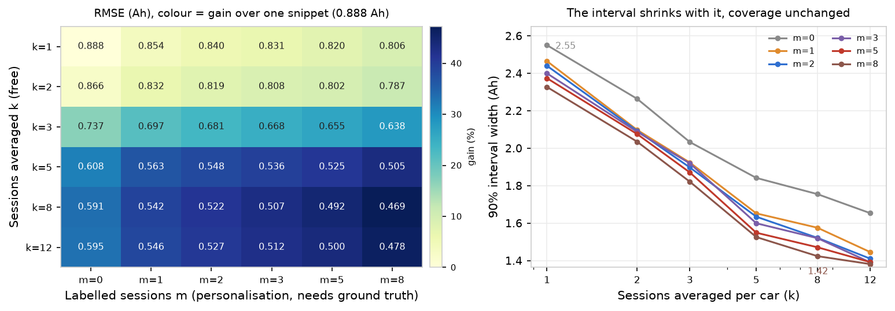
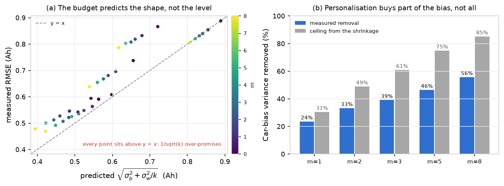
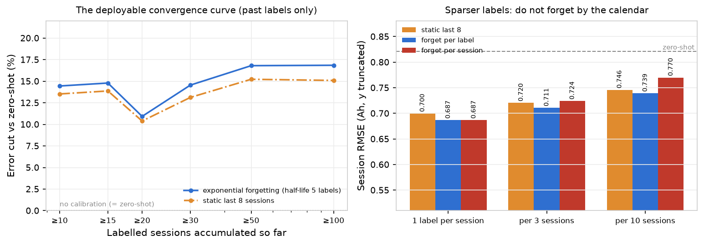
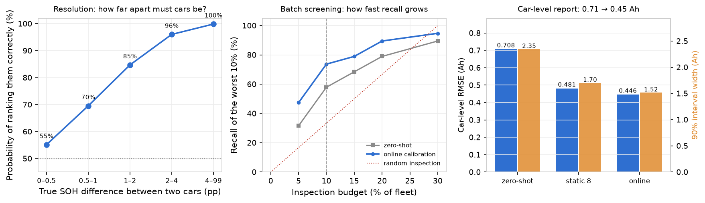
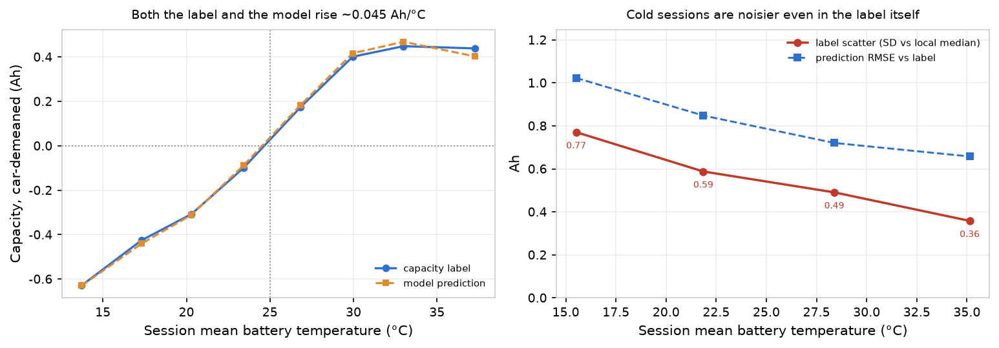
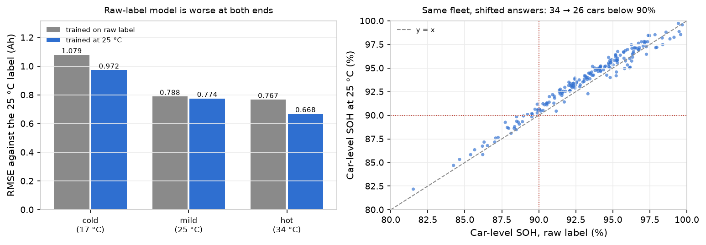

<div align="center">

# 这块电池还剩多少？

### 用一段日常充电片段估计动力电池容量与 SOH

[](https://github.com/ilo-love7/battery-soh-ev-online/actions/workflows/ci.yml)
[](LICENSE)


<p align="center">
  <a href="./README.md">English</a> · <b>简体中文</b>
</p>

<p align="center">
  
</p>

</div>

---

**输入一段充电片段，输出容量（Ah）、SOH（%）以及校准过的 90% 区间。**

不充满、不跑全循环、不要额定容量、不拆包。车开到充电桩时 SOC 23%，走的时候 71%，车端 BMS 记下若干段 128 步的电压／电流／SOC／温度序列 —— 这段残片就是全部输入。本仓库是在清华 **EVBattery** 全量数据（464 辆车 / 173,437 次充电会话 / 1,278,277 个窗口）上把这套流程做通、做实的完整实现。

往下翻之前，四件值得先知道的事：

- **片段长度决定误差下限。** SOC 跨度 ≥ 36% → MAE 低于 **1.5 个 SOH 百分点**；≥ 26% → 低于 **2.0 pp**。跨度不到 25% 时误差大约翻倍（0.96 Ah 对 0.49 Ah）—— 看得太少，模型再好也救不回来。
- **只靠库仑计，还不如直接猜车队均值。** 对 BMS 电流做积分得到 4.42 Ah RMSE，而"一律输出车队均值"是 2.02 Ah。原因是数据集自带的 `Timestamp` 列根本不是时钟（每个窗口都从 0 重新开始），由此得到的 ΔQ/ΔSOC 与容量标签之间存在 **3.485 倍固定标度差**。这两个坑下文都写了处理办法。
- **诚实的区间是要付宽度代价的。** 原始分位数回归在名义 90% 下只覆盖 81.2%；一致性校准把它拉回 90.0%，代价是 ±2.4 Ah 的宽度 —— 即 1.94 pp 的点误差外面套着一个 5.7 pp 的区间。
- **剩下的空间在"报什么"，不在模型。** 模型族、特征集、超参三条轴都已收敛：非线性值 11.5%，但换哪个非线性族只值 3.2%、调参只值 1.7%。把上报口径从"单段"换成"最近 8 段平均"，RMSE 从 0.845 降到 **0.563 Ah**、区间从 2.53 收到 **1.62 Ah**，且完全不需要重训。

---

## 特性

- **片段进，容量与 SOH 出。** `tools/soh_estimator.py` 吃一个装满 BMS 窗口 pkl 的目录，按充电会话逐行打印结果。不需要配置、不需要 notebook、不需要 GPU。
- **114 维特征，来自两个互相独立的族。** 一族是库仑计量（ΔQ、ΔQ/ΔSOC、每 10% SOC 区间的电量），另一族是增量容量形状（dQ/dV 在 3.00–4.25 V 固定网格上 50 mV 分箱）。后者是 SOC 报数带噪声时的兜底手段；第 9 节表明给定库仑计一族之后它不再加分。
- **不会自我美化的评测协议。** 主结论用 **按车分组 5 折** —— 测试车辆完全不参与训练。同车随机切分和留一厂商迁移同时给出，并明确标注哪是乐观上界、哪是悲观下界。
- **校准过的 90% 区间。** 分位数回归（P5/P50/P95）之上再叠三条校准路线（CV+、归一化一致性、**CQR**），其中 **CQR 才是该用的那条**：宽度与 CV+ 相同，但最差 SOC 跨度分箱偏离名义覆盖率 1.8 pp，而 CV+ 是 15.1 pp。配 PIT 直方图与逐车覆盖率，而不是只报一个全局数字。
- **冷启动个性化，两种口径都给。** 用每车 `k` 段有标签会话校正该车的系统偏差，同时报 **时序切分**（可部署）与 **同分布切分**（潜力上限）—— 两者相差 4 倍。
- **工况不变性是测出来的，不是假设的。** 在温度任务上加一个梯度反转头，最冷箱 MAE 降 11.6%、整体 RMSE 降 2.1%；而直觉上更简单的"残差后校正"完全无效 —— 仓库同时给出原因（信噪比只有 15%）。
- **端到端可复现。** 20 个编号脚本、10 个库模块、39 项单元测试；README 里每一张图和每一个 JSON 都能用命令重新生成。

## 结果

跨车外推（P2），38,744 段有标签会话 / 191 辆车，目标是绝对容量（Ah）：

| 模型 | RMSE (Ah) | MAE (Ah) | R² | SOH RMSE (pp) |
|---|---|---|---|---|
| 常数基线（车队均值） | 2.021 | 1.631 | −0.005 | 4.73 |
| 库仑计（标度校准后） | 4.420 | 3.247 | −3.805 | 10.34 |
| 弹性网络 | 0.920 | 0.610 | 0.792 | 2.16 |
| 随机森林 | 0.832 | 0.571 | 0.830 | 1.95 |
| **XGBoost（主模型）** | **0.826** | **0.560** | **0.832** | **1.94** |
| XGBoost，**严格留一车（191 折）** | **0.812** | **0.550** | **0.838** | **1.90** |
| XGBoost，同车随机切分（P1，乐观） | 0.728 | 0.461 | 0.870 | 1.71 |
| MLP，2 × 64 单元（网格最优，慢 2.5 倍） | 0.807 | 0.547 | 0.840 | 1.89 |

**库仑计一族不可少，形状一族不是加法项。** 去掉库仑计，五个模型族一致涨 20%（0.826 → 0.993 Ah）；只留库仑计只涨 0.4%（0.829）—— 库仑量承载绝对电量尺度，而形状特征给不出这个尺度。但反过来的操作几乎免费：删掉全部 45 维增量容量特征只涨 0.3%，MLP 甚至好 1.1%（§9）。形状特征是 SOC 报数不准时的兜底，不是第二个精度来源。

表里 MLP 那一行是 §9 网格的最优格子，列出只为完整；主模型仍是 XGBoost —— 单折 8 s 对 19.7 s，换 2.3% 不值当。

<p align="center">
  
</p>

**区间。** 分位数回归在未见车辆上过度自信；两条互相独立的校准路线都落在名义覆盖率上、宽度也接近 —— 这才是有效信号（只靠一种校准碰巧达标，那叫运气）。

<p align="center">
  
</p>

**跨厂商迁移**（用两个厂商训练，在第三个厂商上测）：直接迁移的偏差始终在 **|bias| ≤ 0.21 Ah** 以内 —— `battery_dataset2` 上 0.882 Ah / R² 0.67，`dataset1` 上 1.138 / 0.64，`dataset3` 上 1.516 / 0.06（只有 8 辆车）。而逐维 z-score 特征对齐反而**处处变差**（0.882 → 2.341 Ah），因为它抹掉了承载容量信息的绝对电量尺度。这个负结果保留在仓库里，没有藏起来；同一失败模式的二阶版本（CORAL）见[再往深处](#再往深处)第 2 节。

**冷启动。** 用有标签会话校正每车偏差确实有用 —— 但有多大用，完全取决于时间是朝哪个方向走的：

<p align="center">
  
</p>

同分布切分下，20 段会话换来 **11.8%** 的 MAE 下降；时序切分下，同样 20 段只换来 **2.9%**。这个差距不是 bug：车级偏差会随电池老化漂移，所以"拿未来校准现在"在部署时不存在。每个 `k` 的两个数字都写在 `results/metrics/coldstart.json` 里。

**片段得多长？** 误差随 SOC 跨度单调下降，然后走平 —— 过了大约 60%，再多覆盖也不划算：

<p align="center">
  
</p>

## 安装

```bash
git clone https://github.com/ilo-love7/battery-soh-ev-online.git
cd battery-soh-ev-online
python -m venv .venv
source .venv/bin/activate          # Windows: .venv\Scripts\activate
pip install -r requirements.txt
```

Python 3.10–3.12，纯 CPU。`torch` 只为了一件事：EVBattery 的窗口 pkl 是旧版 PyTorch 序列化格式，必须用 `torch.load(..., weights_only=False)` 才能读。本仓库不训练任何神经网络。

## 快速开始

`examples/sample_sessions/` 里提交了三段真实充电片段（38 个窗口文件，403 KB，每段 8–17 个窗口），所以 `pip install` 之后立刻能跑 —— 不需要先下 13.7 GB：

```bash
python tools/soh_estimator.py \
  --dir examples/sample_sessions \
  --ref-capacity "18=42.8,62=41.4,383=43.1"
```

```
Model: results/models/xgb_capacity.joblib  (38,744 sessions / 191 cars, leave-cars-out RMSE 0.83 Ah)

 car segment  d_soc  duration_h  n_windows  quality  capacity_Ah  ref_Ah  soh_pct status
  18     368   85.1        6.00         17    0.994        40.15    42.8     93.8     ok
  62     282   54.9        4.59         13    0.960        38.38    41.4     92.7     ok
 383     276   30.0        2.82          8    0.793        41.21    43.1     95.6     ok
```

列含义：`d_soc` 是这段片段实际覆盖的 SOC 跨度（%），`quality` 是片段可用性得分（0–1），`capacity_Ah` 是模型的绝对容量估计，`ref_Ah` 是你给的 BOL 参考容量，`soh_pct = capacity_Ah / ref_Ah`。

上面的参考容量是这三辆车真实的 BOL 值，取自数据集的容量标签历史。数据集给的标签分别是 40.24 / 37.50 / 41.57 Ah，所以三个估计的误差是 0.09 / 0.88 / 0.36 Ah。

`--ref-capacity` 有两点要注意：

- 它接受标量（`--ref-capacity 42.0`），也接受按车的键值对（`18=42.8,62=41.4`）。不填就用车队 BOL 均值（42.6 Ah），此时 `soh_pct` 是"相对车队"的数，不是"相对本车"的数。
- SOH 是**相对该车自身 BOL 容量**的，因为数据集没有额定容量。跨车型比较 SOH 没有意义，要比就比 `capacity_Ah`。

加 `--json out.json` 可以把同一张表落成机器可读的记录。

## 用自己的数据

完整数据集在 figshare（[10.6084/m9.figshare.23301881](https://doi.org/10.6084/m9.figshare.23301881)，CC BY-NC-SA）。按下面的结构放：

```
EVBattery/
  battery_dataset1/data/  *.pkl
  battery_dataset2/data/  *.pkl
  battery_dataset3/data/  *.pkl
```

把流水线指向这个根目录有两种方式：改 `configs/config.yaml` 里的 `paths.evbattery_root`，或者设环境变量 `EVBATTERY_ROOT`。然后把某次会话的窗口文件放进一个文件夹用 `--dir`，或者直接点名：

```bash
python tools/soh_estimator.py --files 470521.pkl 470522.pkl 470523.pkl \
  --data-root /path/to/EVBattery/battery_dataset1 \
  --ref-capacity 42.0
```

模型包（`results/models/xgb_capacity.joblib`，3.5 MB）随仓库一起发布，里面含模型、有序特征清单、车队 BOL 均值与物理标度因子 —— 所以刚 clone 下来不重训也能直接估计。

## 方法要点

| 环节 | 做法 |
|---|---|
| 片段筛选 | 窗口级：128 步完整、电流非静置、SOC 跳变 ≤ 30%；会话级：ΔSOC ≥ 20%、至少 1 个有效窗口 |
| 特征（114 维） | ① 库仑计：ΔQ、ΔQ/ΔSOC、每 10% SOC 区间电量 ② **IC dQ/dV 在 3.00–4.25 V 固定网格（50 mV）分箱** —— 25 原始 + 25 归一化 ③ 5 个粗电压窗口的穿越时长与电量 ④ 工况上下文与 5 分量质量分 |
| 标签 | `SOH = 容量 / BOL 参考`，参考取**该车容量标签最高 10% 的中位数**（稳健 BOL 代理）。模型回归的是**绝对容量**，SOH 事后导出，标签不会泄漏进目标 |
| 协议 | P1 同车随机（乐观上界）／**P2 按车分组 5 折（主结论）**／留一厂商外推 |
| 区间 | 分位数回归 P5/P50/P95 + **CQR（该用的那条）**，CV+ 与归一化一致性作对照基线；PIT 直方图做诊断 |
| 个性化 | 每车用 `k` 段会话做仿射偏差校正，向恒等映射收缩（λ = 5）；时序与同分布两种切分分别报告 |

## EVBattery 格式里的两个坑

这两个坑都花了不少时间才定位，所以写在这里，并在 `tests/` 里用断言钉住。

**1. `Timestamp` 不是时钟。** 第 8 列在*每个*窗口内部都从 0 重新开始，所以按 `t_start` 排序会把一个 17 窗口的会话压成 1 个窗口。正确顺序是**文件名里编码的全局窗口编号**（`219441.pkl < 219442.pkl < ...`）：同一会话内相邻编号恰好相差 1 的比例是 100%，按编号排序后 SOC 单调上升的比例是 99.9%。`src/evsoh/session.py` 用文件编号重建全局时间轴。

**2. 原始 ΔQ/ΔSOC 差了一个恒定的 3.485 倍。** 用 `Charging_Current` 对 `Timestamp` 积分再除以 ΔSOC，得到的量与容量成正比但标度是错的 —— 这个因子很稳定（围绕 3.485 的 IQR 只有 0.43，等效 Δt ≈ 2.87 s），但逐样本还会波动约 12%。这正是"物理基线"只有 4.42 Ah、而常数基线有 2.02 Ah 的直接原因。`src/evsoh/session.py` 同时保留原始量与标度校正量，`scripts/04_physics_baseline.py` 只在训练折上拟合这个因子。

## 复现完整流程

```bash
export EVBATTERY_ROOT=/path/to/EVBattery   # 或改 configs/config.yaml 里的 paths.evbattery_root
python -m pytest tests/ -q                 # 39 项单元测试
python scripts/01_index_windows.py --workers 16    # 127.8 万窗口 → 约 10 分钟
python scripts/02_session_features.py --workers 14 # 3.87 万会话 → 约 3 分钟
python scripts/03_eda.py                   # 数据体检 + 图 1–5
python scripts/04_physics_baseline.py      # 库仑计基线 + 图 6
python scripts/05_train_models.py          # 训练／消融 + 图 7–10，约 11 分钟
python scripts/06_generalization.py        # 留一厂商 + 图 11
python scripts/07_uncertainty.py           # 90% 区间 + 图 12–13
python scripts/08_coldstart.py             # 冷启动个性化 + 图 14–15
python scripts/09_error_analysis.py        # 误差分层 + 图 16–17
python scripts/10_readme_figures.py        # docs/figures/ 里的英文标注图

# 后续深化（首发之后补做，见下文"再往深处"）
python scripts/11_ic_peaks.py              # 50 mV 网格上的 IC 峰特征 + 图 18–19
python scripts/12_lovo_decomposition.py    # 严格留一车（191 折）+ 图 20–21
python scripts/13_cqr.py                   # CQR 区间 + 条件覆盖率 + 图 22
python scripts/14_personalize_quality.py   # 个性化策略 + 质量门控 + 图 23–24
python scripts/15_ic_fine.py               # 3000 段抽样上的 10 mV IC + 图 25–26
python scripts/16_condition_norm.py        # 温度不变性（GRL）+ 图 27–28
python scripts/17_sequence_model.py        # 原始曲线 vs 手工特征 + 图 29–30
python scripts/18_ensemble_intervals.py    # 深度集成 vs CQR + 图 31–32
python scripts/19_model_frontier.py        # 5 族 × 4 特征集 × 6 变体 + 图 33–34，约 38 分钟
python scripts/20_interval_floor.py        # 同车聚合 + 标签噪声地板 + 图 35–36
python scripts/21_aggregate_personalize.py # 聚合 × 标定网格、六种聚合器、偏差漂移 + 图 37–38
python scripts/22_online_noise_decision.py # 在线序贯标定、标签块噪声、决策指标 + 图 39–41，约 3 分钟
python scripts/23_temperature_confound.py  # 温度混杂、25°C 折算与重训 + 图 42–44，约 6 分钟
```

`EVBATTERY_ROOT` 要指向含 `battery_dataset1/2/3` 的目录。脚本 17、18 需要原始 pkl 或 01–02 的缓存，其余只读 `session_features.parquet`。

01–02 的缓存落在 `results/cache/`（不进 git，约 110 MB，16 核约 13 分钟可重算）。03–20 把 36 张中文标注图写进 `results/figures/`，20 份指标 JSON 写进 `results/metrics/`。`scripts/10` 只用缓存结果重绘上面那十三张英文图，所以需要对应脚本已经跑过。

11–20 支持复用缓存，调图不必重训：

| 开关 | 作用 |
|---|---|
| `REUSE_LOVO=1` | 复用 `lovo_predictions.parquet`，跳过 191 折重训（约 15 分钟 → 0） |
| `REUSE_CORAL=1` | 复用 `lovo_domain_transfer.json`，跳过留一厂商的三组训练 |
| `REUSE_PERS=1` | 复用脚本 14 的 JSON，只重绘图 |
| `--replot`（脚本 11 / 15 / 16 / 17 / 18 / 19 / 20） | 用已落盘结果重画图 |
| `--diag-only`（脚本 18） | 只重算交叉拟合的残差诊断，约 3 分钟 |
| `SMOKE=1`（脚本 16 / 17 / 19） | 只跑一折，验证接口 |
| `ONLY_SET=<set>`（脚本 19） | 只跑一个特征集那一列，再 `--assemble` 合并 |

仓库结构：

```
configs/config.yaml     路径、片段筛选、标签定义、评测协议
src/evsoh/              config · data · session · features · target · models
                        evaluate · personalize · nn · plotting
scripts/01–20           上面那条流水线
tools/soh_estimator.py  端到端 CLI（pkl → 容量 / SOH / 质量分）
examples/sample_sessions/  3 段真实会话，38 个窗口文件
docs/figures/           README 里的十三张英文标注图
results/models/         xgb_capacity.joblib（3.5 MB，随仓库发布）
reports/                完整中文评测报告（994 行，全部数据与结论）
```

## 再往深处

首发之后补做的十项研究，由 `scripts/11`–`20` 复现。其中两项把主结论的数字收得更准，一项拿到了真实增益（工况不变性）；其余是刻意保留的负结果 —— 因为每一个都界定了"看起来合理的想法"到底能换来什么。

### 1. 增量容量峰：真实存在，但不值这些参数

dQ/dV 峰是教科书上的 SOH 指标，最自然的做法就是检出峰、把峰位／峰高／峰宽喂给模型。在 50 mV 网格上这件事因为一个机械原因失败：**96.8% 的会话只能检出一个峰**（38,744 段里 37,503 段），50 mV 根本不足以把两个相变分开。

| 特征集 | 特征数 | RMSE (Ah) | Δ RMSE |
|---|---|---|---|
| 50 mV IC 分箱（基线） | 114 | **0.826** | — |
| + 20 个峰描述子 | 134 | 0.824 | −0.3% |
| 用峰**替代**分箱 | 111 | 0.887 | **+7.3%** |

把 3,000 段会话（按 SOH 五分位分层抽样）重采到 **10 mV** 网格后，峰结构确实存在 —— 众数会话有四个峰 —— 而且**第二个峰**才是锐的那个：与 SOH 的 Spearman ρ = **+0.354**，第一个峰只有 +0.144。但更细的分辨率仍然不划算：

| 特征集 | 特征数 | RMSE (Ah) |
|---|---|---|
| 50 mV 分箱 | 48 | **0.898** |
| 10 mV 分箱 | 100 | 0.910 |
| 10 mV 分箱 + 峰 | 125 | 0.908 |
| 只用峰 | 48 | 1.133 |

那 25 个分箱值本来就包含了峰所概括的信息，而峰把曲线其余部分全扔了。结论：**可解释性有收益，精度是净损失。** 分箱保留。

### 2. 严格留一车：五折没有自我美化

主协议按车分组 5 折，任意两个训练集之间仍共享约 **115 / 191 辆车** —— 折与折并不独立。改成 **191 折、每次只留出一辆车**（913 秒，8 进程）：

| 协议 | RMSE (Ah) | MAE (Ah) | R² | SOH RMSE (pp) |
|---|---|---|---|---|
| 按车分组 5 折（主结论） | 0.826 | 0.560 | 0.832 | 1.94 |
| **严格留一车（191 折）** | **0.812** | **0.550** | **0.838** | **1.90** |

严格 LOVO 反而**略好**，不是更差 —— 每折有 190 辆训练车，多出来的数据盖过了更硬的协议。难度集中在长尾：逐车 RMSE 中位数 0.70 Ah，p90 是 1.15 Ah，最差 3.17 Ah，而且**最差的四辆车全部来自 `battery_dataset3`**（那个只有 8 辆车的厂商）。

把逐车 RMSE 对两个特征块做回归，就能把"能改的"和"改不动的"分开：

| 特征块 | 单独 R² | 边际贡献 |
|---|---|---|
| 片段属性（SOC 跨度、质量分、温度、倍率、会话数） | 18.9% | **+11.6 pp** |
| 车身份（里程、BOL 容量、化学体系、SOH 离散度） | 55.8% | **+48.5 pp** |
| 两者合并 | **67.4%** | — |

<p align="center">
  
</p>

跨车误差有三分之二可被解释，而其中绝大部分由**车是谁**决定。这就是"片段长度是硬门槛"的定量版本：剩下那 32.6% 才是更好的模型还能争的空间。系数上有一点要留神 —— 属性块里只有 `quality_med` 符号稳定（ρ = −0.23，标准化系数 −0.26）；一旦加入厂商哑变量，SOC 跨度的系数会翻正，因为那几辆 `dataset3` 车恰好"片段又长、误差又大"。191 行样本、回归量还共线，这种车级回归就会这样。

**域对齐帮不上忙。** CORAL（把源域白化后按目标域协方差重着色）是标准的二阶做法，而它在每一个留出厂商上都输给"什么都不做"：

| 留出厂商 | 不对齐 | z-score 对齐 | CORAL |
|---|---|---|---|
| `battery_dataset1` | **1.139** | 1.609 | 2.073 |
| `battery_dataset2` | **0.884** | 2.595 | 2.024 |
| `battery_dataset3` | **1.506** | 2.082 | 2.234 |

失败模式很具体：对齐一阶或二阶统计量等于给特征空间**重新标度**，而绝对电量尺度正是信号本身。任何"把分布拉平"的方法都会按定义把它毁掉。无监督对齐救不了一个关于尺度、而不是关于分布的问题。

这里的 z-score 一列在 `dataset2` 上是 2.595 Ah，而"结果"一节引用的是 2.341 Ah：这次先做中位数插补再取矩，早前那次用 NaN 感知矩。效应与结论完全一致，但两个数不能混用，所以都列出来。

### 3. CQR：同样的宽度，好得多的条件覆盖率

四种区间方法，名义 90%，全部在同一份 38,744 条折外预测上评估：

| 方法 | 覆盖率 | 宽度 (Ah) | 宽度 (pp SOH) | 最差 SOC 跨度分箱 |
|---|---|---|---|---|
| 原始分位数回归 | 79.8% | 1.92 | 4.51 | 偏离 11.2 pp |
| CV+ | 90.0% | 2.44 | 5.72 | 偏离 **15.1 pp** |
| 归一化一致性 | 89.9% | 2.54 | 5.97 | 偏离 3.0 pp |
| **CQR** | 89.5% | **2.45** | 5.75 | 偏离 **1.8 pp** |

CV+ 与 CQR 在全局覆盖率上打平、宽度也打平 —— 然后在**覆盖率落在哪里**上彻底分道。CV+ 给每个区间加同一个常数，于是长片段过度覆盖（70–100% 跨度上 92.6%）、短片段严重不足（**20–30% 跨度上只有 74.9%**）。CQR 校准的是分位数的**展宽**，区间保持不对称，各跨度分箱落在 88.2%–91.3% 之间。

<p align="center">
  
</p>

这是唯一一处"后续研究改变了推荐做法"的地方：**CQR 取代 CV+ 成为区间方法的首选。** 逐折修正量平均 0.27 Ah（范围 0.18–0.42），校准集用每折训练车里 25% 的车辆 —— 7,000–8,400 段，从不包含测试车。

### 4. 个性化：该用哪种校正，该标哪几段

两种切分下对比三种校正 —— 单项偏差、完整逐车仿射 `a·p + b`、向恒等收缩的 3 参数岭回归头：

<p align="center">
  
</p>

| 策略（时序切分） | k=1 | k=5 | k=20 | 相对零样本 |
|---|---|---|---|---|
| 只用偏差 | 0.599 | 0.596 | 0.585 | **+2.9%** |
| 仿射 `a·p+b` | 0.875 | 0.692 | 0.610 | −1.2% |
| 岭回归头 | 0.893 | 0.707 | 0.633 | −5.1% |
| **偏差 + 挑最好的 k 段** | **0.585** | **0.568** | **0.560** | **+7.1%** |

两个发现。第一，**参数更多不是更好**：k=1 时仿射把 MAE 弄坏 45%、岭回归头弄坏 47%，而且到 k=20 都没赢过单项偏差。这套数据只支持"每车一个偏置"。第二，**标哪几段和标多少段一样重要**：挑质量 × SOC 跨度最高的 `k` 段，把时序口径的收益从 2.9% 拉到 7.1%，而且在 k=1 就开始见效。

同分布切分下顺序反过来 —— 纯偏差校正 k=20 到 12.6%，而按质量挑样本只有 10.7%。偏差在**漂移**时，挑长而干净的片段有用（它们的偏差估计噪声更小）；偏差**平稳**时，挑样本只是丢掉了多样性。

### 5. 质量门控与鲁棒特征：一个成立，一个不成立

**拒收低质片段是有效的，而且单调。** 模型完全不动，只是不报低于质量阈值的片段：

| 质量阈值 | 保留会话 | MAE (Ah) |
|---|---|---|
| 不设 | 100% | 0.560 |
| ≥ 0.80 | 90.5% | 0.534 |
| ≥ 0.85 | 79.0% | 0.520 |
| ≥ 0.90 | 64.3% | 0.511 |
| ≥ 0.95 | 46.2% | **0.483** |

扔掉最差的一半片段换来 13.8% 的 MAE 下降。这是**覆盖率**上的交换，不是建模增益，但对车队筛查是对的交换：拒答一次不花钱，报错一个数要赔一个质保决策。

**剔除对倍率／温度敏感的特征换不来鲁棒性。** 把与平均电流或平均温度 |Spearman| ≥ 0.35 的 58 个特征全删掉（114 → 56 维），整体 RMSE 反而涨 3.6%（0.826 → 0.856），而且代价恰好集中在最想要鲁棒性的地方：

| 温度分层 | 全量 114 维 | 鲁棒 56 维 |
|---|---|---|
| 低温（< 15 ℃） | 0.810 | 0.824（+1.7%） |
| 中温（15–30 ℃） | 0.601 | 0.618（+2.8%） |
| 高温（≥ 30 ℃） | **0.404** | **0.449（+11.1%）** |

冷热 MAE 之比几乎没变（2.0× → 1.8×），而高温层坏了 11%。与倍率、温度相关的特征承载的是真实的容量信号 —— 主要因为"高温大电流的会话往往是长会话" —— 删掉它们删的是信息，不是偏差。温度补偿需要显式的物理模型，不是特征过滤。

### 6. 工况归一化：温度不变性只能在表示层买

首发时标出一个短板：冷片段误差是热片段的 2.3 倍，且没有显式补偿。上一节已经证明"删掉温度相关特征"不管用。这一轮把剩下两条路都实现一遍，再加一个朴素的后校正做对照，全部在同一套按车 5 折内完成，统计量只用训练折估计。

| 做法 | 作用位置 | RMSE (Ah) | 变化 | 温度 MAE 极差 |
|---|---|---|---|---|
| XGBoost 基线 | — | 0.8227 | — | 2.54×（0.360–0.913） |
| 残差后校正 | 输出层 | 0.8243 | +0.2% | 2.45× |
| 全特征去温度化 | 特征层 | 0.8414 | +2.3% | **2.15×** |
| 只去形状特征 | 特征层 | 0.8241 | +0.2% | 2.61× |
| MLP，不开对抗头 | 模型层 | 0.8202 | −0.3% | 2.35× |
| **MLP + 梯度反转（GRL）** | **表示层** | **0.8052** | **−2.1%** | **2.24×** |

"MLP，不开对抗头"这一行不是凑数。没有它，"GRL 有效"和"MLP 本来就比 XGBoost 好"无法区分。拆开看：换模型只带来 −0.3%（噪声级），打开对抗目标再降 **1.8%**，温度极差从 2.35× 压到 2.24×。这 1.8% 是不变性约束的功劳，不是模型容量。

**残差后校正为什么无效**，值得说清楚，因为它是最直觉的做法。按温度分箱，残差中位数只从 −0.23 Ah（< 10 ℃）漂到 −0.05 Ah（> 36 ℃），跨度 0.18 Ah；而残差的四分位距有 1.2 Ah。**信噪比 15%**，任何低容量校正器都学不到东西——实测折内残差 MAE 反而从 0.5839 升到 0.5920。温度敏感性不是输出端残留的偏置，而在"特征到容量"的映射里：模型在低温下因为电压低、内阻大而把电池读得更老。所以只能在表示层动手。

收益的分布也印证这一点，几乎全部落在最冷的箱：

| 温度 | 样本数 | XGBoost MAE | GRL MAE | 变化 |
|---|---|---|---|---|
| < 10 ℃ | 122 | 0.913 | 0.807 | **−11.6%** |
| 10–18 ℃ | 8,379 | 0.761 | 0.747 | −1.9% |
| 18–24 ℃ | 9,352 | 0.621 | 0.604 | −2.8% |
| 24–30 ℃ | 8,929 | 0.510 | 0.498 | −2.3% |
| 30–36 ℃ | 8,691 | 0.418 | 0.408 | −2.3% |
| > 36 ℃ | 3,271 | 0.360 | 0.360 | +0.2% |

"全特征去温度化"能把极差压得更低（2.15×），但它是靠**毁掉信息**做到的：最冷的箱反而变差（0.913 → 约 0.901，代价是整体 RMSE 掉 2.3%）。那是用精度换平稳。GRL 是唯一两边都改善的变体。

代价要说清楚：GRL 需要 MLP，比 XGBoost 慢一个量级，还多两个超参（对抗强度 λ、温度分箱数）。离线评估没问题；车端推理需要蒸馏回树模型。

### 7. 序列模型 vs 手工特征：特征是资产，不是瓶颈

整条流水线用 114 维手工特征。最自然的问题是：为什么不把原始 128×8 窗口直接喂给网络？这一轮在**同一批 11,966 段会话、同一套按车 5 折**上回答，把"表示"和"模型"拆开：

| 表示 | 模型 | RMSE (Ah) | MAE | R² | 变化 |
|---|---|---|---|---|---|
| 114 维手工特征 | XGBoost | 0.8519 | 0.5769 | 0.8221 | — |
| 114 维手工特征 | MLP | **0.8267** | **0.5547** | **0.8325** | −3.0% |
| 原始曲线（256×5） | 1D CNN | 1.0801 | 0.7689 | 0.7141 | **+26.8%** |

序列侧对应深化文档 D1 的"片段长短不一"：把轨迹沿 **SOC 轴**（不是时间轴）等距重采样到 256 点，五个通道是 V / I / T / dV·dSOC⁻¹ / 覆盖率掩码。不同长度、不同起点的片段因此在 SOC 轴上对齐，掩码告诉网络哪一段真的被观测到。

**结论反直觉：原始曲线明显更差（+26.8%）。** 这不是网络没训好——早停、梯度裁剪、winsorize 都做了，训练损失正常下降。原因是手工特征里已经编码了 CNN 很难从曲线里学到的量：库仑计积分 ΔQ、ΔQ/ΔSOC、IC 分箱。这些都是**积分量**，需要网络自己沿 SOC 轴累加，而样本只有 1.2 万条、每条一个会话。三层卷积加两次池化的感受野约 40 个网格点，覆盖不到 1/6 的 SOC 范围。

**序列模型能救短片段吗？不能。** 原本的假设是"曲线看的是形状而不是累计电量，短片段应该更占优"：

| SOC 跨度 | XGBoost+手工 | MLP+手工 | 1D CNN+曲线 |
|---|---|---|---|
| 20–30% | 0.907 | 0.913 | 1.130 |
| 70–100% | 0.548 | 0.521 | 0.716 |

相对劣势确实略小（短片段差 24.5%、长片段差 30.6%），但绝对值全面更差。短片段难是因为信息不足——SOC 只走了 20 个点——换表示不能把信息变出来。

**唯一的正面发现**：三种表示的误差相关系数是 xgb–mlp **0.911**、xgb–seq **0.708**、mlp–seq 0.718，序列模型的误差确实更独立。以最优 15% 权重融进 XGBoost，RMSE 从 0.8519 降到 0.8454（−0.8%）。但同样的融合收益，"XGBoost + MLP 等权"能白拿 3.8%（0.8519 → 0.8196）——**换表示的性价比远低于换模型**。

**修正（第 9 节）**：完整网格确认了这个排序，但把两个数字都收窄了 —— 非线性值 11.5%，换哪个非线性族只值 3.2%，而表示侧根本没有向上的空间：给定库仑计后 45 维形状特征是冗余的。

### 8. 区间宽度已经触到噪声下限

首发报了 ±2.4 Ah 的区间并称其偏宽。这一轮补上深化文档要求的第三档——深度集成——并回答宽度到底能不能压。

| 方法 | 覆盖率 | 宽度 (Ah) | 宽度 (pp) | 低于/高于 | 最差箱偏离 |
|---|---|---|---|---|---|
| 分位数回归 P5/P95 | 79.8% | 1.921 | 4.51 | 8.5% / 11.7% | 11.2 pp |
| **CQR** | **89.5%** | 2.452 | 5.75 | **5.3% / 5.2%** | **1.7 pp** |
| 深度集成（7 种子） | 19.9% | 0.335 | 0.79 | 35.7% / 44.4% | 72.4 pp |
| 集成 + conformal | 90.0% | **2.364** | 5.55 | 6.9% / 3.1% | 10.8 pp |

**深度集成在这里完全失效**：7 个 MLP 给出的 5–95% 跨度只有 0.335 Ah，覆盖率 19.9%。它们训练在同一批数据、同一架构上，只有初始化不同，预测高度相关。集成离散度衡量的是**模型**不确定性，而这批数据的误差主要来自**标签**噪声——两回事。

把集成校准一下（最后一行）宽度降到 2.364 Ah，比 CQR 窄 3.6%，看着像赢了；但条件覆盖崩了：最差箱偏离 10.8 pp（CQR 只有 1.7 pp），20–30% 跨度箱只覆盖 79.2%。失败模式和 CV+ 一样——集成分位宽度几乎不随片段长度变化，conformal 只能加一个常数，于是长片段过度覆盖、短片段欠覆盖。CQR 的分位数回归本身带条件异方差结构，这才是它赢的地方。

**宽度还能不能压？不能。** 两条证据：

1. 用特征预测 `|残差|`，按车 5 折交叉拟合的 R² 只有 **0.145**（样本内拟合会报 0.267，高估近一倍）。残差里只有 14.5% 是可学结构，85% 是噪声。
2. `|残差|` 中位数 0.381 Ah、P90 1.218 Ah。残差分布允许的最小对称 90% 区间是 2 × P90(|r|) = **2.436 Ah**。CQR 实测 2.452 Ah——基本贴在地板上。

所以 2.45 Ah 不是方法不行，是**标签噪声的下限**。要更窄只有两条路：让标签更准（实测安时积分替代作者估计），或者用同车历史做个性化（那是另一个假设）。

**修订（第 10 节）**：这个下限只针对单个片段。把同一辆车最近 k 次会话取平均，k=8 时宽度降到 1.62 Ah；直接测量显示标签噪声只占方差 41%，不是 85%。这个下限应当读作"一个片段能告诉你多少"，而不是"这份数据集能告诉你多少"。

### 9. 三条轴该往哪投：模型族、表示、还是超参？

第 7 节结尾那句"换模型比换表示划算"来自两次两两对比。这一轮把三条轴铺在同一张网格上：
5 个模型族 × 4 个特征集，外加 6 个族内调参变体，同一套按车分组 5 折。括号内是相对现主模型
（全量特征 + XGBoost，0.8260 Ah）的变化：

| 模型族 | 全量 114 维 | 去库仑计 | 只库仑计 | 去工况上下文 |
|---|---|---|---|---|
| ElasticNet（线性） | 0.920 (+11.4%) | 1.507 (+82.5%) | 0.927 (+12.2%) | 0.947 (+14.6%) |
| 随机森林 | 0.840 (+1.7%) | 1.101 (+33.3%) | 0.841 (+1.8%) | 0.840 (+1.7%) |
| HistGB | 0.828 (+0.3%) | 1.011 (+22.4%) | 0.831 (+0.6%) | 0.826 (+0.0%) |
| **XGBoost（现主模型）** | **0.826** | 0.993 (+20.2%) | 0.829 (+0.3%) | 0.824 (−0.2%) |
| MLP | 0.814 (−1.4%) | 0.944 (+14.3%) | 0.817 (−1.1%) | 0.816 (−1.2%) |

**先说一个方法论上的坑**：`ABLATIONS["curve_only"]` 与 `ABLATIONS["no_coulomb"]` 在分组规则下是
**同一个集合**（全量减掉库仑计 = 形状 + SOC 时长 + 工况上下文），照原样跑会有两列完全相同。
第四列改用 `no_context`，这个等价关系也写进了脚本注释。另外随机森林这一行与上面结果表略有出入：网格里用的是降本配置（300 棵、depth 12，0.840 vs 0.832），因为这一轮是 20 次训练而不是 1 次。

**轴 1：非线性值 11.5%，换哪个非线性族只值 3.2%。** 线性模型 0.920，四个非线性族都落在
0.814–0.840。所以"要不要用非线性模型"值 11.5%，"用随机森林还是 XGBoost 还是 MLP"只值 3.2%。
这个任务对模型族不敏感，只对有没有非线性敏感。

**轴 2：表示侧没有向上的空间，只有向下的风险。** 四档里 `full` 最好。删掉库仑计是唯一致命的
改动（MLP +14.3%，线性模型 +82.5%）。第 6.2 节曾说 IC 形状特征能在库仑计缺失时"兜底"，
这一轮要修正：兜不住——最好的模型也只是把损失从 +82.5% 压到 +14.3%。而 45 维形状特征在
给定库仑计 + 上下文后**约等于零收益**（0.829 vs 0.826，MLP 甚至好 1.1%）。去掉 27 个工况
上下文特征同样不掉点。

**轴 3：调参几乎不值钱。** XGB 三个变体极差 1.7%（最好是"更浅 + 更强正则"，−0.9%），
HistGB 0.5%，MLP 0.9%。而且"更深"是负收益（+0.8%）：900 棵、depth 6 在这个数据规模上已经过拟合。

**最优格子与它的代价**：`full + mlp_narrow`（64 单元两层 MLP）0.8073 Ah，比主模型好 2.3%，
代价是单折 19.7 s vs 8.0 s（2.5 倍）。性价比最高的是 `xgb_shallow`：−0.7%，只要 2.8 s。

**一个有意思的交互**：MLP 相对 XGBoost 的优势随表示变弱而扩大——全量上 −1.4%，
去掉库仑计后 **−4.9%**（0.9442 vs 0.9929）。网络确实能从形状特征里榨出更多，但远不足以替代
缺失的库仑计信息。这也解释了第 7 节的原始序列 CNN 为什么救不回来：缺的是信息，不是表示的灵活性。

<p align="center">
  
</p>

### 10. 区间没有触底，是"报什么"这个口径太窄了

第 8 节说 2.45 Ah 是标签噪声的下限。这话对**单个片段单独上报**成立，但车不是这么用的：
一辆车一年充电几百次，合理的做法是报"最近 k 次的平均"。同一套 OOF 预测、不重训任何模型，
只换上报口径：

| 聚合段数 k | RMSE (Ah) | MAE (Ah) | 90% 宽度 (Ah) | 覆盖率 |
|---|---|---|---|---|
| 1（单片段） | 0.845 | 0.586 | 2.53 | 88.7% |
| 2 | 0.700 | 0.499 | 2.06 | 88.7% |
| 3 | 0.679 | 0.476 | 1.93 | 88.0% |
| 5 | 0.657 | 0.448 | 1.86 | 89.3% |
| 8 | **0.563** | **0.404** | **1.62** | 88.5% |
| 12 | 0.556 | 0.401 | 1.72 | 88.9% |

每辆车按里程切成连续窗，每车每个 k 最多取 12 个窗（车辆等权），并且只保留 ≥12 段的车辆，
所以每个 k 都是同一批车。k=1 的 0.845 是等车权重口径，与主表的片段加权 0.826 略有差异。

**收益不是 1/√k。** 按方差分解（σ_b = 0.449、σ_w = 0.725）推的理论曲线是
`√(σ_b² + σ_w²/k)`，实测比它高 3%–19%。把实测曲线反解成"等效独立样本数"：
k = 1…12 分别只有 1.0、1.8、2.0、2.3、4.6、4.9。12 次会话只换来约 5 次独立观测的信息量
——车内误差是正相关的，原因见下面的误差预算。

**这不是"长片段的代理"。** 在每个 SOC 跨度箱内单独比较 k=1 与 k=4，收益处处存在：
−39%（30–40% 跨度）、−19%（40–50%）、−25%（50–60%）、−25%（60–70%）、−15%（70–100%）。
短片段多测几次，比等一个长片段更划算。

**实用对照**：宽度要到 2.5 Ah 需 k=2，2.0 Ah 需 k=3，1.8 Ah 需 k=8；1.5 Ah 在 k ≤ 12 内
**不可达**。

**为什么平均会饱和——直接测出来的原因。** 同一辆车相邻两次充电的真实容量几乎不变，
所以两个标签之差近似就是噪声之差（先扣掉每车容量-里程的线性趋势）：

- **19.8% 的相邻会话容量标签精确相同**。连续量不会偶然重复，说明标签来自比会话更稀疏的
  测量、被复制到了相邻会话上；连续重复的游程平均 1.24 个会话、最长 7 个。
- 分布是**尖峰 + 重尾**：std 法 σ = 0.547 Ah，MAD 法 σ = 0.204 Ah，相差 2.7 倍。

按"能不能被平均掉"拆方差：

| 成分 | σ (Ah) | 方差占比 | 多测几次能消除吗 |
|---|---|---|---|
| 车级偏差 | 0.449 | 28% | 不能，是硬地板 |
| 车内模型误差 | 0.476 | 31% | 能，按 1/√k 衰减 |
| 标签噪声 | 0.547 | 41% | 部分能（被复制的标签完全相关） |
| **合计** | **0.853** | 100% | — |

一张表解释三件事：平均有用，是因为 31% 的方差是车内模型误差；平均会饱和，是因为 28% 是
车级偏差（k=8 的 0.563 Ah 距 0.449 Ah 的地板只剩 25%）；等效 k 停在 5 而不是 12，
是因为被复制的标签让相邻误差完全相关。

**这同时修正了第 8 节。** "85% 是噪声"来自"预测 `|残差|` 的 R² = 0.145"的补集，
衡量的是**不可预测的结构**，不是**标签噪声**。直接测量给出的标签噪声只占方差 41%，
其余是模型误差。所以模型并没有做完：相对高斯 MAE 地板 0.437 Ah，实测 0.560 Ah 还有 28% 的空间。

<p align="center">
  
</p>

### 11. 聚合与个性化不是二选一，而是先后关系

第 10 节把误差拆成三块，并给每块指定了一个杠杆：车级偏差 → 个性化、车内模型误差 → 同车平均、
标签噪声 → 没有杠杆。前两个杠杆打的是互不重叠的两块，但**从未一起测过**（第 4 节的个性化是在
单个片段上做的，第 10 节的聚合完全不做校正）。这一节把它们铺在同一张网格上。

口径（刻意比第 10 节严格，所以绝对值不可直接比）：每车按里程从中位数切开，前一半做**校准池**、
后一半做**评估集**；bias 只从校准池里**最近**的 m 段带标签会话估计（部署时能拿到的就是这些），
收缩 λ=5 沿用原设定。进入实验 187 车（≥24 段），每车每 k 最多 12 窗。

**RMSE（Ah），单片段零样本基线 0.888：**

| k \ m | 0 | 1 | 2 | 3 | 5 | 8 |
|---|---|---|---|---|---|---|
| 1 | 0.888 | 0.854 | 0.840 | 0.831 | 0.820 | 0.806 |
| 2 | 0.866 | 0.832 | 0.819 | 0.808 | 0.802 | 0.787 |
| 3 | 0.737 | 0.697 | 0.681 | 0.668 | 0.655 | 0.638 |
| 5 | 0.608 | 0.563 | 0.548 | 0.536 | 0.525 | 0.505 |
| 8 | 0.591 | 0.542 | **0.522** | 0.507 | 0.492 | **0.469** |
| 12 | 0.595 | 0.546 | 0.527 | 0.512 | 0.500 | 0.478 |

同一张网格上 90% 区间宽度从 2.55 收到 1.42 Ah，覆盖率落在 88.1–90.6%，没有一格是靠牺牲校准换宽度。

**两个杠杆精确可加。** 聚合（m=0，k=1→8）−33.4%，个性化（k=8，m=0→8）−20.7%，
乘积预测 0.888 × 0.665 × 0.793 = 0.4691，实测 **0.4688**，差 0.06%。
两块方差互不重叠，就该长成这样。

**但 k 必须换成 k_eff。** 误差预算 `√(σ_b² + σ_w²/k)` 能把 k=1 那一列复现到 0.1% 以内，
之后**全部落在实测点之上**（k=2 高估 20–28%，k=3 高估 12–18%）。反解 m=0 行得到
k_eff = 1.00 / 1.08 / 1.84 / 4.49 / 5.44 / 5.20（k = 1…12）：**相邻两段只值 1.08 段**，
k 在 8 附近饱和，所以 k=12 白跑（+0.7%）。这和第 10 节"19.8% 标签被复制"是同一件事的两面。

**没有一种聚合器打得过算术平均。** 中位数（k=3 时 +3.1%）、20% 截尾均值（+0.0%）、
按新近加权（+1.4%）、按质量分加权（+0.1%）、按 SOC 跨度加权（+0.8%），最好也只是打平。
稳健统计假设"个别独立离群"，而这里 **36–38% 的标签是成段复制的**，远超任何截尾比例，
且被复制的标签彼此完全相关而非独立。**块相关标签噪声下，稳健聚合失效**——这是可迁移的方法论结论。

**个性化只买得起 56% 的偏差，因为偏差会漂移：**

| m | 1 | 2 | 3 | 5 | 8 |
|---|---|---|---|---|---|
| 实测消掉的偏差方差 | 24% | 33% | 39% | 46% | **56%** |
| 收缩系数给的上限 | 31% | 49% | 61% | 75% | 85% |

缺口不是估计噪声，是漂移：在校准池与评估集上各估一次每车偏差，ρ = 0.688、斜率 0.850
（<1，向均值回归），差值占单侧方差的 41.3%——**只有约六成车级偏差跨时间可迁移**。
所以"车级偏差是硬地板"要加限定：对零样本成立；给 8 段标签能买回 56%，剩下四成是漂移，λ→0 也拿不到。

**部署对照（SOH 按 42.6 Ah 参考容量换算）：**

| 方案 | 采集成本 | RMSE (Ah) | 90% 宽度 (Ah) | SOH RMSE |
|---|---|---|---|---|
| 单片段，零样本 | 1 次充电 | 0.888 | 2.55 | 2.08 pp |
| 平均 8 次，零样本 | 8 次充电 | 0.591 | 1.75 | 1.39 pp |
| 平均 8 次 + 标定 2 段 | 8 + 2 | 0.522 | 1.52 | 1.22 pp |
| 平均 8 次 + 标定 8 段 | 8 + 8 | **0.469** | **1.42** | **1.10 pp** |
| 平均 12 次 + 标定 8 段 | 12 + 8 | 0.478 | 1.38 | 1.12 pp |

按成本顺序读：先吃免费杠杆（8 次充电，−33%），再决定要不要花标签。在 k=8 之上，
第一段标签值 −8.3%、第二段 −3.7%、之后每段约 −1.5%——**1–2 段标定是整张表性价比最高的投入**。

<p align="center">
  
</p>

<p align="center">
  
</p>

### 12. 标定是状态估计问题，不是一次性拟合

第 11 节默认 m 段带标签会话是**一次性**交到手上的。部署不是这样：车一直在跑、标签陆续到达，
估计应该边走边改。第 11 节还有两个只被解释、没被利用的事实：车级偏差会漂移（只有约六成可迁移）、
19.5% 的标签是复制品。这一节把两者都变成方法。

口径：每车按里程排序，预测第 t 段时**只允许**用 t 之前到达的标签，前 10 段是冷启动；
L 表示标签节奏（每 L 段会话产生一个带标签会话）。偏差按 `e = pred − y` 定义，
按有效样本数收缩（`b × n_eff/(n_eff+5)`，与第 4 节同一个 λ）。

| 估计器 | RMSE (Ah) | MAE (Ah) | 相对零样本 |
|---|---|---|---|
| 零样本 | 0.8207 | 0.5554 | — |
| 累积均值（全部历史等权） | 0.7283 | 0.4828 | −11.3% |
| 静态最近 8 段（第 11 节的口径） | 0.6999 | 0.4613 | −14.7% |
| **指数遗忘（按标签节拍，半衰期 5）** | **0.6867** | **0.4508** | **−16.3%** |
| 局部线性外推（最近 8 个标签） | 0.8174 | 0.5577 | −0.4% |

**"忘"比"攒"值钱。** 累积均值输给静态窗 3.4 个百分点、输给指数遗忘 5 个百分点——偏差会漂移，
越老的历史越像噪声。遗忘强度很宽容：半衰期 2/3/5/8/12/20/40 个标签给出
0.7005/0.6916/0.6867/0.6874/0.6909/0.6975/0.7079，5–12 之间是 0.4% 的平台。
线性外推是干净的负结果：漂移不是直线，把带噪斜率推一步，方差就原样还回来。

**遗忘要按标签节拍，不按日历节拍。** 同一个估计器，只改"龄"怎么算：

| 标签节奏 | 零样本 | 静态最近 8 | 静态最近 20 | 按标签节拍遗忘 | 按日历节拍遗忘 |
|---|---|---|---|---|---|
| 每 1 段一个标签 | 0.8207 | 0.6999 | 0.6975 | **0.6867** | 0.6867 |
| 每 3 段一个标签 | 0.8207 | 0.7204 | 0.7217 | **0.7108** | 0.7240 |
| 每 10 段一个标签 | 0.8207 | 0.7459 | 0.7493 | **0.7392** | 0.7700 |

每段都有标签时两者逐位相同；到每 10 段一个标签时差 4.0%。按日历遗忘会把"10 段前那个标签"
折成 1/1024，等于主动丢掉唯一的近邻信息——稀疏标签最怕这件事。

**收敛曲线并不收敛，它一开始就是平的。** 同一套流式口径，只用 ≥110 段的长历史车，保证每档同一批车：

| 累计标签数 | 10+ | 15+ | 20+ | 30+ | 50+ | 100+ |
|---|---|---|---|---|---|---|
| 零样本 RMSE (Ah) | 0.861 | 0.888 | 0.885 | 0.821 | 0.689 | 0.844 |
| 指数遗忘 RMSE (Ah) | 0.737 | 0.757 | 0.788 | 0.702 | 0.573 | 0.702 |
| **同档内削减** | **14.4%** | **14.8%** | **10.9%** | **14.5%** | **16.8%** | **16.8%** |

零样本那一行本身不是平的（残差随车龄变化），所以绝对曲线的下降不能全记在"攒标签"头上。
看同档内的削减：第 10 个标签已经买到 14.4%，第 100 个也只有 16.8%。在线标定的价值是
**"立刻可用"而不是"长期收敛"**——它是局部估计器，10 个标签之后没有更多可学。这也从另一头
解释了第 11 节的 k_eff 饱和。

**标签噪声：对训练无解，对评估有解。** 31,114 个标签块，34.4% 的会话落在长度 >1 的块里
（块均长 1.24、最长 7），19.5% 的会话是复制品。

| 参照目标 | RMSE (Ah) | MAE (Ah) |
|---|---|---|
| 原始标签 | 0.8242 | 0.5592 |
| 留一局部中位数 | **0.7487** | 0.5274 |

**报告出来的误差里约 9% 是标签假象，不是模型误差。** 去噪目标自身与标签的偏差 σ = 0.573，
与第 11 节直接测到的 0.547 独立互证。而按块给训练加权什么也没改变：
0.8245 → 0.8240（每块一票）→ 0.8238（丢弃复制段），即 −0.06% / −0.08%。
这个零结果才是信息：复制的标签伤害的是**评估**和标定的天花板，不是拟合——
平方损失的解是条件均值 E[y|x]，重采样只改权重，不改条件分布。

**从 Ah 走到决策。** 车级上报：最近 8 段的预测均值 + 只用窗口之前标签估的偏差，真值取同 8 段标签均值
（187 辆车，参考容量 42.54 Ah）：

| 方案 | RMSE (Ah) | RMSE (pp) | 90% 宽度 (Ah) | 覆盖率 |
|---|---|---|---|---|
| 零样本 | 0.7078 | 1.66 | 2.348 | 90.4% |
| 静态最近 8 段 | 0.4815 | 1.13 | 1.704 | 88.8% |
| **在线序贯（半衰期 5）** | **0.4464** | **1.05** | **1.518** | 87.2% |

分辨率——17,391 对车，按真实 SOH 差分组看排序判对率：

| 真实差 | 0–0.5 pp | 0.5–1 pp | 1–2 pp | 2–4 pp | >4 pp |
|---|---|---|---|---|---|
| 排序判对率 | 55.1% | 69.5% | 84.7% | 96.0% | 99.9% |

也就是说这套管线的分辨力约 **2 pp**：差 1 pp 只有七成把握，差 2 pp 才到 96%。
在 10% 复检名额下筛查最差 10%（19 辆，SOH ≤ 87.3%），召回从 57.9% 提到 **73.7%**；
5% 名额下从 47.4% 提到 78.9%。把 90% 区间的下界当保守估值，平均只让 **1.64 pp**、
真值跌破下界的比例 8.6%——可以直接进定价流程，而点估计有一半概率报高。

车级误差分布没有被平均掩盖：中位 **0.236 Ah（0.55 pp）**、p90 0.721 Ah、最差车 1.832 Ah。
SOC 跨度仍是最强单因素（三分位 0.580 / 0.320 / 0.395 Ah）；温度分层**不单调**
（0.433 / 0.501 / 0.400）——两头都难，是 U 形，不是"越热越差"。

<p align="center">
  
</p>

<p align="center">
  
</p>

### 13. 标签不是一把固定的尺子，而模型把它学了去

上面所有数字都被读成"模型离标签有多远"，这等于把标签当成一把固定的尺子。它不是：同一辆车内部，
控制里程后**容量标签随电池温度升高 +0.0449 Ah/°C（≈0.11 %/°C）**，而模型复现了其中 **1.008 倍**。
问题不是精度不够，而是**夏天报的 SOH 和冬天报的不是同一个量**。

估计全部在车内做（固定效应），因为温度与车强混杂（热的地方车本身容量也不同）。三种口径必须互相印证：
水平固定效应、一阶差分（同时消掉车效应与任何线性老化趋势）、去复制块。

| 口径 | 标签 (Ah/°C) | 预测 (Ah/°C) | 比值 |
|---|---|---|---|
| 固定效应，仅温度 | 0.0576 | 0.0571 | 0.99 |
| 固定效应 + 里程 | **0.0449** [0.0391, 0.0509] | 0.0452 [0.0417, 0.0492] | **1.008** [0.944, 1.082] |
| 固定效应 + 里程 + 工况 | 0.0457 | 0.0459 | 1.00 |
| 一阶差分 | 0.0484 | 0.0363 | 0.75 |
| 一阶差分，相邻 <3000 km | 0.0491 | 0.0363 | 0.74 |
| 只留复制块首 | 0.0459 | 0.0453 | 0.99 |

第一行是个陷阱：温度与里程在一辆车的历史里一起爬，不控里程会把斜率抬高 28%。这不是边角疏漏——
187 辆车里 91.4% 单独回归也为正（中位 0.054），且响应在 33°C 之后饱和（拐点以下 0.0498、以上 0.0123），
与可逆容量在 35–40°C 见顶一致。

水平口径下模型**完整复制**了这个依赖，差分口径下只跟了四分之三（它把相邻会话的抖动平滑掉了）。
而残差里**根本没有**温度项——这正是 §12 那个"车级偏差漂移"**不是季节性**的原因：先把温度从标签里扣掉再量漂移，
两半相关从 0.752 掉到 0.582。这条否证比证实有用。

**冷天连标签自己都更不稳。** 与同车近邻中位数的差，按温度四分位：0.771 / 0.588 / 0.491 / 0.358 Ah，
预测误差几乎同比例跟随（1.023 / 0.848 / 0.721 / 0.658）。第 6 节那个"冷箱误差是热箱 2.54 倍"里，
有一部分从来不是模型的错。

**折算到 25°C 不花钱**（折算参数按折内训练车估，测试车不参与）：

| 训练目标 | 评估目标 | RMSE (Ah) | MAE (Ah) |
|---|---|---|---|
| 原始标签 | 原始标签 | 0.8184 | 0.5544 |
| 原始标签 | 25°C 标签 | 0.8894 | 0.6368 |
| 25°C 标签 | 25°C 标签 | **0.8145** | **0.5525** |
| 25°C 标签 | 原始标签 | 0.8824 | 0.6236 |

精度不掉（−0.5%），预测的温度斜率从 0.0455 塌到 **0.0014**——特征还在，模型自己不用了。
反面是：原始模型那份"准"里有 8.7% 是从尺子那儿借来的。

车级（最近 8 段，187 辆）：SOH 中位平移 **0.71 pp**，与该窗口比全历史热多少的相关是 −0.83。
排序几乎不动（Spearman 0.982），最差 10% 名单留住 18/19；但 90% 线上有 8 辆换边、92% 线上 12 辆。

**为什么多平均几段没用。** 季节摆幅 2.49 pp ≈ **3.2 万公里**真实老化，但温度是慢波：
全历史跨度中位 26.9°C，最近 8 段窗口里只有 6.96°C（lag-1 自相关 0.882）。连续 8 段落在同一季节里，
平均掉的是标签噪声，不是季节。残留 0.64 pp（SD），相当于 §12 那个车级 MAE（1.05 pp）的 **61%**。

<p align="center">
  
</p>

<p align="center">
  
</p>

### 结论一览

| 方向 | 做了什么 | 结果 |
|---|---|---|
| D1 IC 形状 | 20 个峰描述子、50 mV → 10 mV 重采样、SOC 对齐原始曲线 + CNN | 峰是真的但精度不升；原始曲线差 26.8% —— 分箱保留 |
| D2 跨车泛化 | 191 折 LOVO、误差分解、CORAL、温度域 GRL | 五折是诚实的；车身份解释 56% 的误差方差；厂商对齐有害、**工况对齐有效（−2.1%）** |
| D3 不确定性 | CQR 对 CV+ 对归一化一致性对深度集成 | **CQR 在条件覆盖上胜出**且贴在**单片段**的噪声下限 —— 宽度只能靠放大上报口径再压（D6） |
| D4 冷启动 | 偏差／仿射／岭回归／主动选样 | 只留单项偏差；主动选样把收益提到 2.4 倍 |
| D5 质量 | 拒收门控、鲁棒特征子集、对抗不变性 | 门控有效（13.8%）；特征过滤失败；**不变性约束有效（−2.1%）** |
| D6 轴审计 | 5 个模型族 × 4 个特征集、6 个调参变体、同车聚合、标签噪声直接测量 | 非线性值 11.5%、换族 3.2%、调参 1.7%；表示侧无向上空间；k=8 聚合把宽度从 2.53 压到 1.62 Ah |
| D7 上报口径 | (k, m) 聚合 × 标定网格、六种聚合器、偏差漂移模型、可加性检验 | 两个杠杆精确可加（0.888 → 0.469 Ah，−47%）；k 在 8 饱和（k_eff 5.4）；稳健聚合全失效；个性化只买回 56% 偏差，其余是漂移 |
| D8 流式标定 | 带遗忘的在线序贯偏差、标签节奏扫描、块噪声感知评估、车级决策指标 | 忘比攒值钱（0.821 → 0.687 Ah）；按标签节拍而非日历节拍遗忘；第 10 个标签后削减饱和在 14–17%；训练侧按块加权无效；车级 0.446 Ah（1.05 pp），分辨率约 2 pp |
| D9 温度混杂 | 车内固定效应 + 一阶差分 + 去复制块、按温度分层的标签噪声、折算到 25°C 重训 | 标签带 +0.0449 Ah/°C，模型复制 1.008 倍；季节摆幅 = 3.2 万公里老化；折算不花钱（0.8184 → 0.8145 Ah）且漂移归零（0.0455 → 0.0014） |

## 局限

- **容量标签是数据集作者给出的估计值**，不是实测安时积分。本文所有精度都是"对这套标签的精度"。
- **SOH 的分母是每车历史最健康状态**，因为数据集未给额定容量。因此 SOH 是"相对自身 BOL"的口径，不能跨车型直接比较。
- **464 辆车里只有 191 辆有可用容量标签**（有数据车辆的 41%），`battery_dataset3` 仅 8 辆车 —— "跨厂商"结论恰恰在这里最弱，严格 LOVO 里最差的四辆车也全出自它。
- **无监督特征对齐在本任务上有害**，一阶（z-score，0.882 → 2.341 Ah）与二阶（CORAL，0.884 → 2.024 Ah）都一样。这个负结果如实报告而非调参掩盖，因为它界定了"没有标签时域自适应能做到什么程度"。
- **显式的 IC 峰描述子打不过 IC 分箱**，10 mV 网格也打不过 50 mV。峰特征买来的是可解释性，不是精度；两个都是负结果，都保留。
- **个性化收益受车级偏差时变性限制。** 仓库同时给出潜力上限与可部署数字，两个都不单独引用；逐车仿射校正在这里从来不值它多出来的参数。
- **质量门控是覆盖率交换，不是建模增益。** 它降低 MAE 的唯一方式是拒绝对 20–54% 的会话给数 —— 对车队筛查合适，对"每辆车都必须有数"的场景没用。
- **鲁棒性没有通过特征过滤实现。** 删掉对倍率／温度敏感的特征让 RMSE 涨 3.6%、高温层坏 11%，冷热差距也没缩小。温度补偿需要显式物理模型。
- **工况补偿这条有效路需要神经网络。** 梯度反转把最冷箱 MAE 降 11.6%，但它依赖 MLP —— 比 XGBoost 慢一个量级，还多两个超参。要上车端得先蒸馏回树模型，这一步没做。
- **单个片段的区间宽度无法靠换估计器收窄**：2.45 Ah 与 `2 × P90(|残差|)` 吻合。但宽度并非由方法锁死：同车最近 8 次取平均就是 1.62 Ah，而 19.8% 的相邻会话带着被复制的标签，所以"标签噪声"里有一部分根本不是独立噪声。限制在口径与标签，不在估计器。
- **序列模型在这个数据规模上更差。** SOC 对齐的 1D CNN 比手工特征贵 26.8%。这个结论限定在 1.2 万会话与三层卷积的范围内：它说明手工特征好，不说明序列模型在数据量大得多时也不行。
- **最冷那个箱很薄。** 38,744 段里只有 122 段低于 10 ℃，所以 −11.6% 是小样本估计；排序在各折间一致，但幅度不确定。
- **全文所有容量/SOH 数字都带温度口径。** 它们是各自会话温度下测到的容量，折算到 25°C 后车级中位平移 0.71 pp，跨季节比较前必须先折算。而且温度在本数据集里无法与使用强度分离：快充比例高的车系统性更热、衰减也更快，数据里没有环境温度或充电功率通道可以把两者拆开。

## 引用与许可

如果这套流程或者上面两个数据坑对你有用，请引用数据集：

```bibtex
@article{he2022evbattery,
  title   = {EVBattery: A Large-Scale Electric Vehicle Dataset for Battery Health and Capacity Estimation},
  author  = {He, Mingqiang and others},
  journal = {arXiv preprint arXiv:2201.12358},
  year    = {2022}
}
```

代码是 MIT（[LICENSE](LICENSE)）；EVBattery 数据集是 **CC BY-NC-SA** —— 仅限非商业使用，本仓库不再分发该数据集。`examples/sample_sessions/` 下的 38 个窗口文件是为快速开始演示保留的最小片段，同样遵循该许可。
