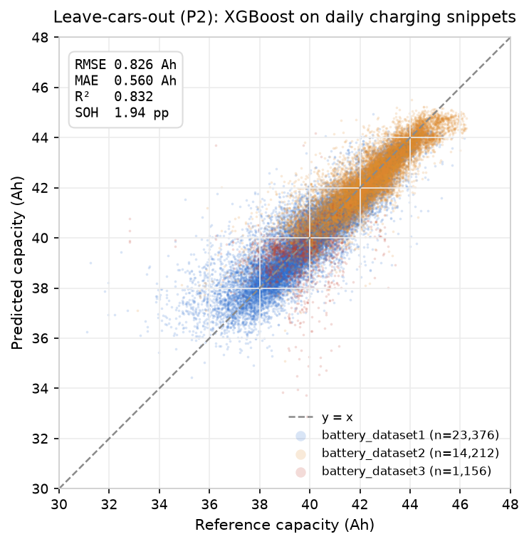
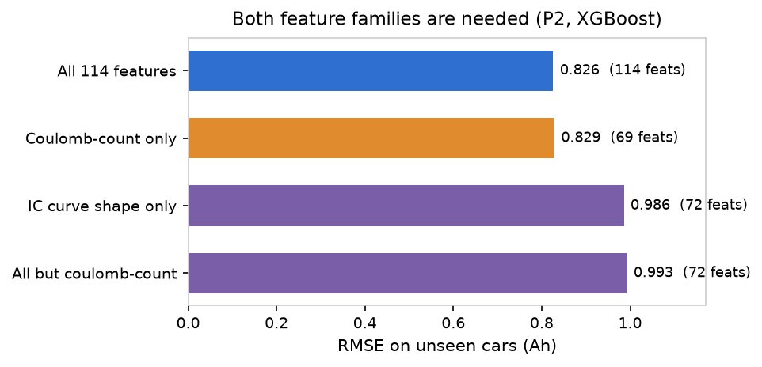
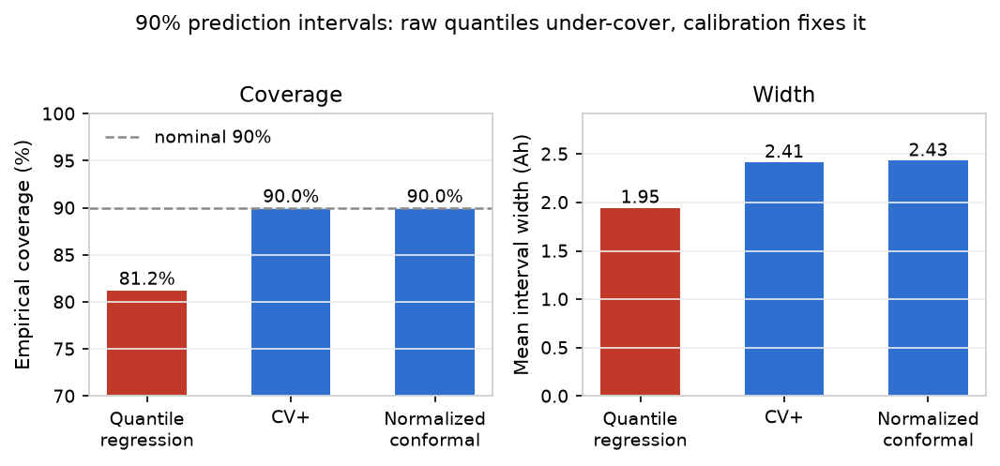
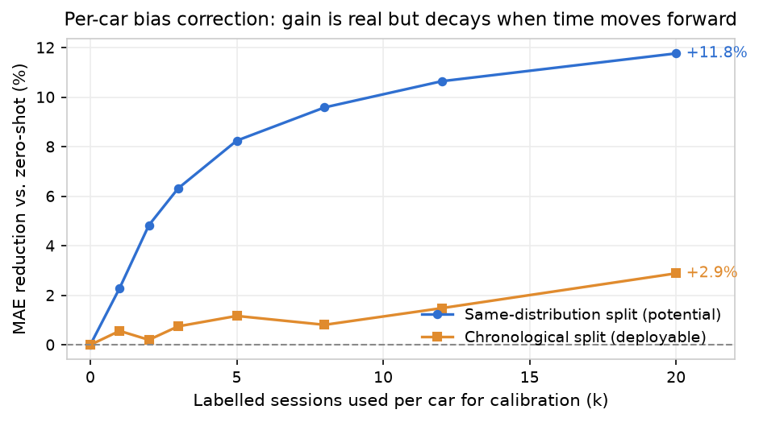
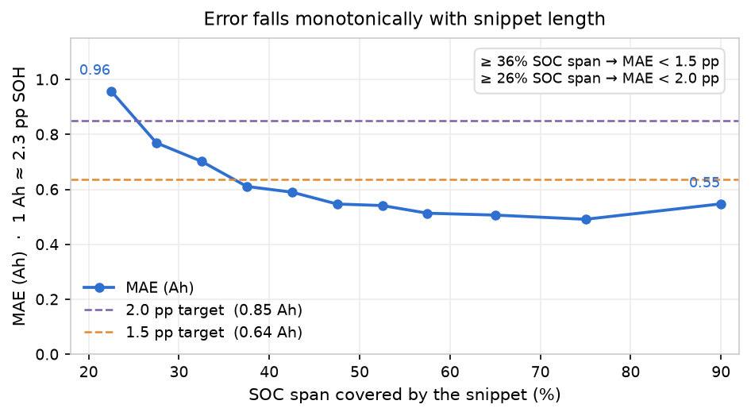
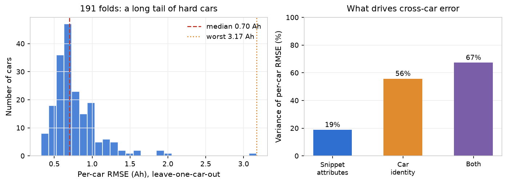
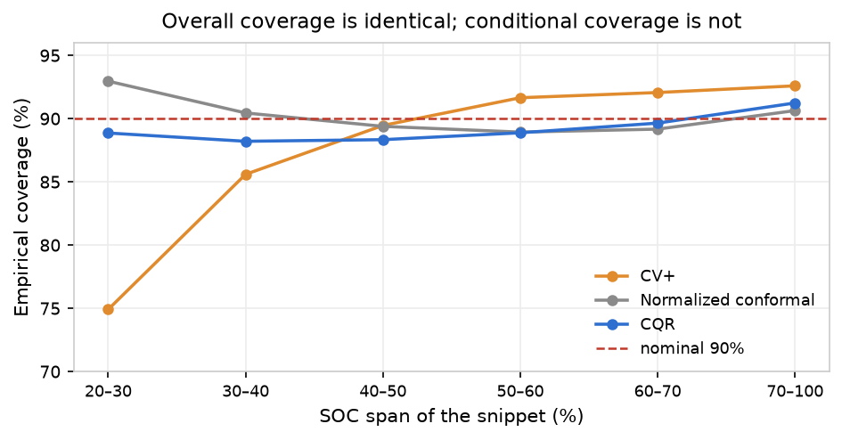
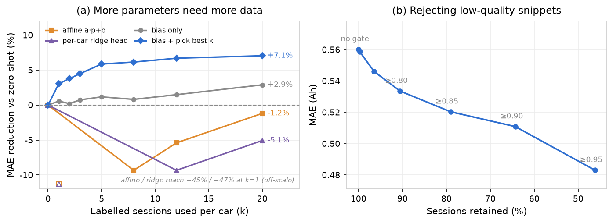

<div align="center">

# 这块电池还剩多少？

### 用一段日常充电片段估计动力电池容量与 SOH

[](https://github.com/ilo-love7/battery-soh-ev-online/actions/workflows/ci.yml)
[](LICENSE)


<p align="center">
  <a href="./README.md">English</a> · <b>简体中文</b>
</p>

<p align="center">
  
</p>

</div>

---

**输入一段充电片段，输出容量（Ah）、SOH（%）以及校准过的 90% 区间。**

不充满、不跑全循环、不要额定容量、不拆包。车开到充电桩时 SOC 23%，走的时候 71%，车端 BMS 记下若干段 128 步的电压／电流／SOC／温度序列 —— 这段残片就是全部输入。本仓库是在清华 **EVBattery** 全量数据（464 辆车 / 173,437 次充电会话 / 1,278,277 个窗口）上把这套流程做通、做实的完整实现。

往下翻之前，三件值得先知道的事：

- **片段长度决定误差下限。** SOC 跨度 ≥ 36% → MAE 低于 **1.5 个 SOH 百分点**；≥ 26% → 低于 **2.0 pp**。跨度不到 25% 时误差大约翻倍（0.96 Ah 对 0.49 Ah）—— 看得太少，模型再好也救不回来。
- **只靠库仑计，还不如直接猜车队均值。** 对 BMS 电流做积分得到 4.42 Ah RMSE，而"一律输出车队均值"是 2.02 Ah。原因是数据集自带的 `Timestamp` 列根本不是时钟（每个窗口都从 0 重新开始），由此得到的 ΔQ/ΔSOC 与容量标签之间存在 **3.485 倍固定标度差**。这两个坑下文都写了处理办法。
- **诚实的区间是要付宽度代价的。** 原始分位数回归在名义 90% 下只覆盖 81.2%；一致性校准把它拉回 90.0%，代价是 ±2.4 Ah 的宽度 —— 即 1.94 pp 的点误差外面套着一个 5.7 pp 的区间。

---

## 特性

- **片段进，容量与 SOH 出。** `tools/soh_estimator.py` 吃一个装满 BMS 窗口 pkl 的目录，按充电会话逐行打印结果。不需要配置、不需要 notebook、不需要 GPU。
- **114 维特征，来自两个互相独立的族。** 一族是库仑计量（ΔQ、ΔQ/ΔSOC、每 10% SOC 区间的电量），另一族是增量容量形状（dQ/dV 在 3.00–4.25 V 固定网格上 50 mV 分箱）。后者才是让估计在 SOC 报数带噪声时仍然站得住的原因。
- **不会自我美化的评测协议。** 主结论用 **按车分组 5 折** —— 测试车辆完全不参与训练。同车随机切分和留一厂商迁移同时给出，并明确标注哪是乐观上界、哪是悲观下界。
- **校准过的 90% 区间。** 分位数回归（P5/P50/P95）之上再叠三条校准路线（CV+、归一化一致性、**CQR**），其中 **CQR 才是该用的那条**：宽度与 CV+ 相同，但最差 SOC 跨度分箱偏离名义覆盖率 1.8 pp，而 CV+ 是 15.1 pp。配 PIT 直方图与逐车覆盖率，而不是只报一个全局数字。
- **冷启动个性化，两种口径都给。** 用每车 `k` 段有标签会话校正该车的系统偏差，同时报 **时序切分**（可部署）与 **同分布切分**（潜力上限）—— 两者相差 4 倍。
- **端到端可复现。** 15 个编号脚本、9 个库模块、22 项单元测试；README 里每一张图和每一个 JSON 都能用命令重新生成。

## 结果

跨车外推（P2），38,744 段有标签会话 / 191 辆车，目标是绝对容量（Ah）：

| 模型 | RMSE (Ah) | MAE (Ah) | R² | SOH RMSE (pp) |
|---|---|---|---|---|
| 常数基线（车队均值） | 2.021 | 1.631 | −0.005 | 4.73 |
| 库仑计（标度校准后） | 4.420 | 3.247 | −3.805 | 10.34 |
| 弹性网络 | 0.920 | 0.610 | 0.792 | 2.16 |
| 随机森林 | 0.832 | 0.571 | 0.830 | 1.95 |
| **XGBoost（主模型）** | **0.826** | **0.560** | **0.832** | **1.94** |
| XGBoost，**严格留一车（191 折）** | **0.812** | **0.550** | **0.838** | **1.90** |
| XGBoost，同车随机切分（P1，乐观） | 0.728 | 0.461 | 0.870 | 1.71 |

**两个特征族都不可少。** 去掉库仑计一族，误差涨 20%（0.826 → 0.993 Ah）；只留库仑计一族，误差只涨 0.4%（0.829）。库仑量承载绝对电量尺度，增量容量承载与 SOC 报数无关的形状信息 —— 而单靠形状不够，因为形状是无尺度的。

<p align="center">
  
</p>

**区间。** 分位数回归在未见车辆上过度自信；两条互相独立的校准路线都落在名义覆盖率上、宽度也接近 —— 这才是有效信号（只靠一种校准碰巧达标，那叫运气）。

<p align="center">
  
</p>

**跨厂商迁移**（用两个厂商训练，在第三个厂商上测）：直接迁移的偏差始终在 **|bias| ≤ 0.21 Ah** 以内 —— `battery_dataset2` 上 0.882 Ah / R² 0.67，`dataset1` 上 1.138 / 0.64，`dataset3` 上 1.516 / 0.06（只有 8 辆车）。而逐维 z-score 特征对齐反而**处处变差**（0.882 → 2.341 Ah），因为它抹掉了承载容量信息的绝对电量尺度。这个负结果保留在仓库里，没有藏起来；同一失败模式的二阶版本（CORAL）见[再往深处](#再往深处)第 2 节。

**冷启动。** 用有标签会话校正每车偏差确实有用 —— 但有多大用，完全取决于时间是朝哪个方向走的：

<p align="center">
  
</p>

同分布切分下，20 段会话换来 **11.8%** 的 MAE 下降；时序切分下，同样 20 段只换来 **2.9%**。这个差距不是 bug：车级偏差会随电池老化漂移，所以"拿未来校准现在"在部署时不存在。每个 `k` 的两个数字都写在 `results/metrics/coldstart.json` 里。

**片段得多长？** 误差随 SOC 跨度单调下降，然后走平 —— 过了大约 60%，再多覆盖也不划算：

<p align="center">
  
</p>

## 安装

```bash
git clone https://github.com/ilo-love7/battery-soh-ev-online.git
cd battery-soh-ev-online
python -m venv .venv
source .venv/bin/activate          # Windows: .venv\Scripts\activate
pip install -r requirements.txt
```

Python 3.10–3.12，纯 CPU。`torch` 只为了一件事：EVBattery 的窗口 pkl 是旧版 PyTorch 序列化格式，必须用 `torch.load(..., weights_only=False)` 才能读。本仓库不训练任何神经网络。

## 快速开始

`examples/sample_sessions/` 里提交了三段真实充电片段（38 个窗口文件，403 KB，每段 8–17 个窗口），所以 `pip install` 之后立刻能跑 —— 不需要先下 13.7 GB：

```bash
python tools/soh_estimator.py \
  --dir examples/sample_sessions \
  --ref-capacity "18=42.8,62=41.4,383=43.1"
```

```
Model: results/models/xgb_capacity.joblib  (38,744 sessions / 191 cars, leave-cars-out RMSE 0.83 Ah)

 car segment  d_soc  duration_h  n_windows  quality  capacity_Ah  ref_Ah  soh_pct status
  18     368   85.1        6.00         17    0.994        40.15    42.8     93.8     ok
  62     282   54.9        4.59         13    0.960        38.38    41.4     92.7     ok
 383     276   30.0        2.82          8    0.793        41.21    43.1     95.6     ok
```

列含义：`d_soc` 是这段片段实际覆盖的 SOC 跨度（%），`quality` 是片段可用性得分（0–1），`capacity_Ah` 是模型的绝对容量估计，`ref_Ah` 是你给的 BOL 参考容量，`soh_pct = capacity_Ah / ref_Ah`。

上面的参考容量是这三辆车真实的 BOL 值，取自数据集的容量标签历史。数据集给的标签分别是 40.24 / 37.50 / 41.57 Ah，所以三个估计的误差是 0.09 / 0.88 / 0.36 Ah。

`--ref-capacity` 有两点要注意：

- 它接受标量（`--ref-capacity 42.0`），也接受按车的键值对（`18=42.8,62=41.4`）。不填就用车队 BOL 均值（42.6 Ah），此时 `soh_pct` 是"相对车队"的数，不是"相对本车"的数。
- SOH 是**相对该车自身 BOL 容量**的，因为数据集没有额定容量。跨车型比较 SOH 没有意义，要比就比 `capacity_Ah`。

加 `--json out.json` 可以把同一张表落成机器可读的记录。

## 用自己的数据

完整数据集在 figshare（[10.6084/m9.figshare.23301881](https://doi.org/10.6084/m9.figshare.23301881)，CC BY-NC-SA）。按下面的结构放：

```
EVBattery/
  battery_dataset1/data/  *.pkl
  battery_dataset2/data/  *.pkl
  battery_dataset3/data/  *.pkl
```

把流水线指向这个根目录有两种方式：改 `configs/config.yaml` 里的 `paths.evbattery_root`，或者设环境变量 `EVBATTERY_ROOT`。然后把某次会话的窗口文件放进一个文件夹用 `--dir`，或者直接点名：

```bash
python tools/soh_estimator.py --files 470521.pkl 470522.pkl 470523.pkl \
  --data-root /path/to/EVBattery/battery_dataset1 \
  --ref-capacity 42.0
```

模型包（`results/models/xgb_capacity.joblib`，3.5 MB）随仓库一起发布，里面含模型、有序特征清单、车队 BOL 均值与物理标度因子 —— 所以刚 clone 下来不重训也能直接估计。

## 方法要点

| 环节 | 做法 |
|---|---|
| 片段筛选 | 窗口级：128 步完整、电流非静置、SOC 跳变 ≤ 30%；会话级：ΔSOC ≥ 20%、至少 1 个有效窗口 |
| 特征（114 维） | ① 库仑计：ΔQ、ΔQ/ΔSOC、每 10% SOC 区间电量 ② **IC dQ/dV 在 3.00–4.25 V 固定网格（50 mV）分箱** —— 25 原始 + 25 归一化 ③ 5 个粗电压窗口的穿越时长与电量 ④ 工况上下文与 5 分量质量分 |
| 标签 | `SOH = 容量 / BOL 参考`，参考取**该车容量标签最高 10% 的中位数**（稳健 BOL 代理）。模型回归的是**绝对容量**，SOH 事后导出，标签不会泄漏进目标 |
| 协议 | P1 同车随机（乐观上界）／**P2 按车分组 5 折（主结论）**／留一厂商外推 |
| 区间 | 分位数回归 P5/P50/P95 + **CQR（该用的那条）**，CV+ 与归一化一致性作对照基线；PIT 直方图做诊断 |
| 个性化 | 每车用 `k` 段会话做仿射偏差校正，向恒等映射收缩（λ = 5）；时序与同分布两种切分分别报告 |

## EVBattery 格式里的两个坑

这两个坑都花了不少时间才定位，所以写在这里，并在 `tests/` 里用断言钉住。

**1. `Timestamp` 不是时钟。** 第 8 列在*每个*窗口内部都从 0 重新开始，所以按 `t_start` 排序会把一个 17 窗口的会话压成 1 个窗口。正确顺序是**文件名里编码的全局窗口编号**（`219441.pkl < 219442.pkl < ...`）：同一会话内相邻编号恰好相差 1 的比例是 100%，按编号排序后 SOC 单调上升的比例是 99.9%。`src/evsoh/session.py` 用文件编号重建全局时间轴。

**2. 原始 ΔQ/ΔSOC 差了一个恒定的 3.485 倍。** 用 `Charging_Current` 对 `Timestamp` 积分再除以 ΔSOC，得到的量与容量成正比但标度是错的 —— 这个因子很稳定（围绕 3.485 的 IQR 只有 0.43，等效 Δt ≈ 2.87 s），但逐样本还会波动约 12%。这正是"物理基线"只有 4.42 Ah、而常数基线有 2.02 Ah 的直接原因。`src/evsoh/session.py` 同时保留原始量与标度校正量，`scripts/04_physics_baseline.py` 只在训练折上拟合这个因子。

## 复现完整流程

```bash
python -m pytest tests/ -q                 # 22 项单元测试
python scripts/01_index_windows.py --workers 16    # 127.8 万窗口 → 约 10 分钟
python scripts/02_session_features.py --workers 14 # 3.87 万会话 → 约 3 分钟
python scripts/03_eda.py                   # 数据体检 + 图 1–5
python scripts/04_physics_baseline.py      # 库仑计基线 + 图 6
python scripts/05_train_models.py          # 训练／消融 + 图 7–10，约 11 分钟
python scripts/06_generalization.py        # 留一厂商 + 图 11
python scripts/07_uncertainty.py           # 90% 区间 + 图 12–13
python scripts/08_coldstart.py             # 冷启动个性化 + 图 14–15
python scripts/09_error_analysis.py        # 误差分层 + 图 16–17
python scripts/10_readme_figures.py        # docs/figures/ 里的英文标注图

# 后续深化（首发之后补做，见下文"再往深处"）
python scripts/11_ic_peaks.py              # 50 mV 网格上的 IC 峰特征 + 图 18–19
python scripts/12_lovo_decomposition.py    # 严格留一车（191 折）+ 图 20–21
python scripts/13_cqr.py                   # CQR 区间 + 条件覆盖率 + 图 22
python scripts/14_personalize_quality.py   # 个性化策略 + 质量门控 + 图 23–24
python scripts/15_ic_fine.py               # 3000 段抽样上的 10 mV IC + 图 25–26
```

01–02 的缓存落在 `results/cache/`（不进 git，约 110 MB，16 核约 13 分钟可重算）。03–15 把 26 张中文标注图写进 `results/figures/`，15 份指标 JSON 写进 `results/metrics/`。`scripts/10` 只用缓存的预测重绘上面那几张英文图，所以需要 05–09 已经跑过。

仓库结构：

```
configs/config.yaml     路径、片段筛选、标签定义、评测协议
src/evsoh/              config · data · session · features · target · models
                        evaluate · personalize · plotting
scripts/01–15           上面那条流水线
tools/soh_estimator.py  端到端 CLI（pkl → 容量 / SOH / 质量分）
examples/sample_sessions/  3 段真实会话，38 个窗口文件
docs/figures/           README 里的英文标注图
results/models/         xgb_capacity.joblib（3.5 MB，随仓库发布）
reports/                完整中文评测报告（655 行，全部数据与结论）
```

## 再往深处

首发之后补做的五项研究，由 `scripts/11`–`15` 复现。其中两项把主结论的数字收得更准，三项是刻意保留的负结果 —— 因为每一个都界定了"看起来合理的想法"到底能换来什么。

### 1. 增量容量峰：真实存在，但不值这些参数

dQ/dV 峰是教科书上的 SOH 指标，最自然的做法就是检出峰、把峰位／峰高／峰宽喂给模型。在 50 mV 网格上这件事因为一个机械原因失败：**96.8% 的会话只能检出一个峰**（38,744 段里 37,503 段），50 mV 根本不足以把两个相变分开。

| 特征集 | 特征数 | RMSE (Ah) | Δ RMSE |
|---|---|---|---|
| 50 mV IC 分箱（基线） | 114 | **0.826** | — |
| + 20 个峰描述子 | 134 | 0.824 | −0.3% |
| 用峰**替代**分箱 | 111 | 0.887 | **+7.3%** |

把 3,000 段会话（按 SOH 五分位分层抽样）重采到 **10 mV** 网格后，峰结构确实存在 —— 众数会话有四个峰 —— 而且**第二个峰**才是锐的那个：与 SOH 的 Spearman ρ = **+0.354**，第一个峰只有 +0.144。但更细的分辨率仍然不划算：

| 特征集 | 特征数 | RMSE (Ah) |
|---|---|---|
| 50 mV 分箱 | 48 | **0.898** |
| 10 mV 分箱 | 100 | 0.910 |
| 10 mV 分箱 + 峰 | 125 | 0.908 |
| 只用峰 | 48 | 1.133 |

那 25 个分箱值本来就包含了峰所概括的信息，而峰把曲线其余部分全扔了。结论：**可解释性有收益，精度是净损失。** 分箱保留。

### 2. 严格留一车：五折没有自我美化

主协议按车分组 5 折，任意两个训练集之间仍共享约 **115 / 191 辆车** —— 折与折并不独立。改成 **191 折、每次只留出一辆车**（913 秒，8 进程）：

| 协议 | RMSE (Ah) | MAE (Ah) | R² | SOH RMSE (pp) |
|---|---|---|---|---|
| 按车分组 5 折（主结论） | 0.826 | 0.560 | 0.832 | 1.94 |
| **严格留一车（191 折）** | **0.812** | **0.550** | **0.838** | **1.90** |

严格 LOVO 反而**略好**，不是更差 —— 每折有 190 辆训练车，多出来的数据盖过了更硬的协议。难度集中在长尾：逐车 RMSE 中位数 0.70 Ah，p90 是 1.15 Ah，最差 3.17 Ah，而且**最差的四辆车全部来自 `battery_dataset3`**（那个只有 8 辆车的厂商）。

把逐车 RMSE 对两个特征块做回归，就能把"能改的"和"改不动的"分开：

| 特征块 | 单独 R² | 边际贡献 |
|---|---|---|
| 片段属性（SOC 跨度、质量分、温度、倍率、会话数） | 18.9% | **+11.6 pp** |
| 车身份（里程、BOL 容量、化学体系、SOH 离散度） | 55.8% | **+48.5 pp** |
| 两者合并 | **67.4%** | — |

<p align="center">
  
</p>

跨车误差有三分之二可被解释，而其中绝大部分由**车是谁**决定。这就是"片段长度是硬门槛"的定量版本：剩下那 32.6% 才是更好的模型还能争的空间。系数上有一点要留神 —— 属性块里只有 `quality_med` 符号稳定（ρ = −0.23，标准化系数 −0.26）；一旦加入厂商哑变量，SOC 跨度的系数会翻正，因为那几辆 `dataset3` 车恰好"片段又长、误差又大"。191 行样本、回归量还共线，这种车级回归就会这样。

**域对齐帮不上忙。** CORAL（把源域白化后按目标域协方差重着色）是标准的二阶做法，而它在每一个留出厂商上都输给"什么都不做"：

| 留出厂商 | 不对齐 | z-score 对齐 | CORAL |
|---|---|---|---|
| `battery_dataset1` | **1.139** | 1.609 | 2.073 |
| `battery_dataset2` | **0.884** | 2.595 | 2.024 |
| `battery_dataset3` | **1.506** | 2.082 | 2.234 |

失败模式很具体：对齐一阶或二阶统计量等于给特征空间**重新标度**，而绝对电量尺度正是信号本身。任何"把分布拉平"的方法都会按定义把它毁掉。无监督对齐救不了一个关于尺度、而不是关于分布的问题。

这里的 z-score 一列在 `dataset2` 上是 2.595 Ah，而"结果"一节引用的是 2.341 Ah：这次先做中位数插补再取矩，早前那次用 NaN 感知矩。效应与结论完全一致，但两个数不能混用，所以都列出来。

### 3. CQR：同样的宽度，好得多的条件覆盖率

四种区间方法，名义 90%，全部在同一份 38,744 条折外预测上评估：

| 方法 | 覆盖率 | 宽度 (Ah) | 宽度 (pp SOH) | 最差 SOC 跨度分箱 |
|---|---|---|---|---|
| 原始分位数回归 | 79.8% | 1.92 | 4.51 | 偏离 11.2 pp |
| CV+ | 90.0% | 2.44 | 5.72 | 偏离 **15.1 pp** |
| 归一化一致性 | 89.9% | 2.54 | 5.97 | 偏离 3.0 pp |
| **CQR** | 89.5% | **2.45** | 5.75 | 偏离 **1.8 pp** |

CV+ 与 CQR 在全局覆盖率上打平、宽度也打平 —— 然后在**覆盖率落在哪里**上彻底分道。CV+ 给每个区间加同一个常数，于是长片段过度覆盖（70–100% 跨度上 92.6%）、短片段严重不足（**20–30% 跨度上只有 74.9%**）。CQR 校准的是分位数的**展宽**，区间保持不对称，各跨度分箱落在 88.2%–91.3% 之间。

<p align="center">
  
</p>

这是唯一一处"后续研究改变了推荐做法"的地方：**CQR 取代 CV+ 成为区间方法的首选。** 逐折修正量平均 0.27 Ah（范围 0.18–0.42），校准集用每折训练车里 25% 的车辆 —— 7,000–8,400 段，从不包含测试车。

### 4. 个性化：该用哪种校正，该标哪几段

两种切分下对比三种校正 —— 单项偏差、完整逐车仿射 `a·p + b`、向恒等收缩的 3 参数岭回归头：

<p align="center">
  
</p>

| 策略（时序切分） | k=1 | k=5 | k=20 | 相对零样本 |
|---|---|---|---|---|
| 只用偏差 | 0.599 | 0.596 | 0.585 | **+2.9%** |
| 仿射 `a·p+b` | 0.875 | 0.692 | 0.610 | −1.2% |
| 岭回归头 | 0.893 | 0.707 | 0.633 | −5.1% |
| **偏差 + 挑最好的 k 段** | **0.585** | **0.568** | **0.560** | **+7.1%** |

两个发现。第一，**参数更多不是更好**：k=1 时仿射把 MAE 弄坏 45%、岭回归头弄坏 47%，而且到 k=20 都没赢过单项偏差。这套数据只支持"每车一个偏置"。第二，**标哪几段和标多少段一样重要**：挑质量 × SOC 跨度最高的 `k` 段，把时序口径的收益从 2.9% 拉到 7.1%，而且在 k=1 就开始见效。

同分布切分下顺序反过来 —— 纯偏差校正 k=20 到 12.6%，而按质量挑样本只有 10.7%。偏差在**漂移**时，挑长而干净的片段有用（它们的偏差估计噪声更小）；偏差**平稳**时，挑样本只是丢掉了多样性。

### 5. 质量门控与鲁棒特征：一个成立，一个不成立

**拒收低质片段是有效的，而且单调。** 模型完全不动，只是不报低于质量阈值的片段：

| 质量阈值 | 保留会话 | MAE (Ah) |
|---|---|---|
| 不设 | 100% | 0.560 |
| ≥ 0.80 | 90.5% | 0.534 |
| ≥ 0.85 | 79.0% | 0.520 |
| ≥ 0.90 | 64.3% | 0.511 |
| ≥ 0.95 | 46.2% | **0.483** |

扔掉最差的一半片段换来 13.8% 的 MAE 下降。这是**覆盖率**上的交换，不是建模增益，但对车队筛查是对的交换：拒答一次不花钱，报错一个数要赔一个质保决策。

**剔除对倍率／温度敏感的特征换不来鲁棒性。** 把与平均电流或平均温度 |Spearman| ≥ 0.35 的 58 个特征全删掉（114 → 56 维），整体 RMSE 反而涨 3.6%（0.826 → 0.856），而且代价恰好集中在最想要鲁棒性的地方：

| 温度分层 | 全量 114 维 | 鲁棒 56 维 |
|---|---|---|
| 低温（< 15 ℃） | 0.810 | 0.824（+1.7%） |
| 中温（15–30 ℃） | 0.601 | 0.618（+2.8%） |
| 高温（≥ 30 ℃） | **0.404** | **0.449（+11.1%）** |

冷热 MAE 之比几乎没变（2.0× → 1.8×），而高温层坏了 11%。与倍率、温度相关的特征承载的是真实的容量信号 —— 主要因为"高温大电流的会话往往是长会话" —— 删掉它们删的是信息，不是偏差。温度补偿需要显式的物理模型，不是特征过滤。

### 结论一览

| 方向 | 做了什么 | 结果 |
|---|---|---|
| D1 IC 形状 | 20 个峰描述子、50 mV → 10 mV 重采样 | 峰是真的，精度没提升 —— 分箱保留 |
| D2 跨车泛化 | 191 折 LOVO、误差分解、CORAL | 五折是诚实的；56% 的误差来自车身份；对齐有害 |
| D3 不确定性 | CQR 对 CV+ 对归一化一致性 | **CQR 在条件覆盖上胜出** —— 方法已更换 |
| D4 冷启动 | 偏差／仿射／岭回归／主动选样 | 只留单项偏差；主动选样把收益翻倍 |
| D5 质量 | 拒收门控、鲁棒特征子集 | 门控有效（13.8%）；鲁棒子集失败（+3.6% 且不鲁棒） |

## 局限

- **容量标签是数据集作者给出的估计值**，不是实测安时积分。本文所有精度都是"对这套标签的精度"。
- **SOH 的分母是每车历史最健康状态**，因为数据集未给额定容量。因此 SOH 是"相对自身 BOL"的口径，不能跨车型直接比较。
- **464 辆车里只有 191 辆有可用容量标签**（有数据车辆的 41%），`battery_dataset3` 仅 8 辆车 —— "跨厂商"结论恰恰在这里最弱，严格 LOVO 里最差的四辆车也全出自它。
- **无监督特征对齐在本任务上有害**，一阶（z-score，0.882 → 2.341 Ah）与二阶（CORAL，0.884 → 2.024 Ah）都一样。这个负结果如实报告而非调参掩盖，因为它界定了"没有标签时域自适应能做到什么程度"。
- **显式的 IC 峰描述子打不过 IC 分箱**，10 mV 网格也打不过 50 mV。峰特征买来的是可解释性，不是精度；两个都是负结果，都保留。
- **个性化收益受车级偏差时变性限制。** 仓库同时给出潜力上限与可部署数字，两个都不单独引用；逐车仿射校正在这里从来不值它多出来的参数。
- **质量门控是覆盖率交换，不是建模增益。** 它降低 MAE 的唯一方式是拒绝对 20–54% 的会话给数 —— 对车队筛查合适，对"每辆车都必须有数"的场景没用。
- **鲁棒性没有通过特征过滤实现。** 删掉对倍率／温度敏感的特征让 RMSE 涨 3.6%、高温层坏 11%，冷热差距也没缩小。温度补偿需要显式物理模型。

## 引用与许可

如果这套流程或者上面两个数据坑对你有用，请引用数据集：

```bibtex
@article{he2022evbattery,
  title   = {EVBattery: A Large-Scale Electric Vehicle Dataset for Battery Health and Capacity Estimation},
  author  = {He, Mingqiang and others},
  journal = {arXiv preprint arXiv:2201.12358},
  year    = {2022}
}
```

代码是 MIT（[LICENSE](LICENSE)）；EVBattery 数据集是 **CC BY-NC-SA** —— 仅限非商业使用，本仓库不再分发该数据集。`examples/sample_sessions/` 下的 38 个窗口文件是为快速开始演示保留的最小片段，同样遵循该许可。
